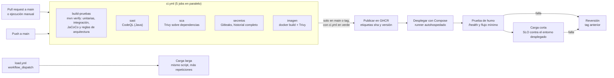

# Pipeline de entrega continua y segura

Este documento describe cómo se construye, verifica, publica y despliega Minecraft2: el diagrama del pipeline, qué hace cada etapa, qué umbral la detiene y por qué se eligió ese valor, y el procedimiento de reversión. Lo lee quien revisa o mantiene el pipeline. Los pasos para instalar y operar el sistema desde cero están en la [guía de implementación](implementacion.md); el modelo de amenazas y los controles de seguridad, en [seguridad.md](seguridad.md).

> **Estado del documento: parcial.** El workflow de integración continua, `.github/workflows/ci.yml`, existe y tuvo una ejecución completa en verde ([ejecución 43487176016](https://github.com/MarshallGomez1103/Mc2/actions/runs/43487176016), commit `b9f06d3`, pull request #1); tras fusionar ese pull request, la ejecución sobre `main` ([43736236291](https://github.com/MarshallGomez1103/Mc2/actions/runs/43736236291), commit `572b65b`) también pasó sus cinco jobs. El ruleset de `main` exige los cinco checks (sección 4) y dos de los controles tienen una demostración de bloqueo (sección 2). Todavía no existen `cd.yml`, `load.yml`, el despliegue ni la reversión. Cada elemento marcado «Previsto — responsable: Persona N» se completa con la ejecución real y el marcador se retira antes de la entrega. Aquí no se escribe ningún resultado, enlace de ejecución ni duración que no provenga de una ejecución de GitHub Actions.

Responsables: Persona 3 (despliegue, carga, reversión) con Persona 1 (integración continua, protección de `main`, versionado).

## 1. Diagrama del pipeline

La parte de integración continua (`ci.yml`) corresponde al workflow real. La publicación, el despliegue y la carga (`cd.yml`, `load.yml`) siguen previstas — responsable: Persona 3, y se ajustan a los jobs reales cuando existan esos archivos.

- `ci.yml` se dispara en `pull_request` hacia `main`, en `push` a `main` y a demanda (`workflow_dispatch`). Una rama con un pull request abierto genera una sola ejecución de integración continua, la del pull request. Los cinco jobs no declaran dependencias entre sí (`needs`), de modo que el tiempo total es el del job más lento y no la suma.
- Cada job es un check independiente del pull request. Su identificador en el YAML es el nombre del check (`build-pruebas`, `sast`, `sca`, `secretos`, `imagen`), sin nombre personalizado; renombrar un job rompe la regla del ruleset que lo exija. El ruleset de `main` exige esos cinco checks (sección 4).
- Permisos del workflow: `contents: read` y nada más. El resultado de CodeQL se conserva como artefacto y no se sube a la pestaña Security, por lo que no se necesita `security-events: write`.
- Cada job tiene `timeout-minutes` (10 o 15). Una ejecución de pull request se cancela cuando llega un push nuevo a la misma rama; las ejecuciones de `main` nunca se cancelan.
- Las acciones de terceros están fijadas por SHA completo de commit, con la versión como comentario: `actions/checkout` v7.0.1, `actions/setup-java` v6.2.0, `actions/upload-artifact` v7.0.2 y `github/codeql-action` v4.39.3. Trivy 0.76.2 y Gitleaks 8.30.1 se descargan en cada ejecución con verificación de suma SHA-256 y no se instalan en el runner de forma permanente.
- En `main` o con un tag `vX.Y.Z` correrá `cd.yml`, que solo publicará y desplegará si `ci.yml` terminó en verde. Previsto — responsable: Persona 3.
- Ninguna etapa de `ci.yml` usa `continue-on-error`: una etapa que falla detiene el pipeline.

## 2. Etapas y umbrales

Las etapas son las del enunciado (sección 2.2); el análisis de seguridad se separa en SAST, SCA y secretos porque cada uno es un job. Las filas con job son las de `ci.yml` y cada una indica en «Estado» el resultado de la ejecución enlazada; la columna distingue lo que ya existe y pasó de lo que se construirá.

| Etapa | Qué verifica | Herramienta | Detiene el pipeline cuando… | Por qué ese valor | Estado |
| --- | --- | --- | --- | --- | --- |
| Construcción (job `build-pruebas`) | Que el código compila con Java 17 y que las dependencias de [`pom.xml`](../pom.xml) se resuelven. | Maven (`mvn -B -ntp verify`, Java 17 Temurin, caché de Maven) | No compila o no se resuelve una dependencia. | Sin un artefacto compilado no hay nada que probar ni desplegar. Java 17 es la versión del POM y del [`Dockerfile`](../Dockerfile), de modo que el pipeline prueba el mismo entorno que se entrega. | Implementado: pasa en 39 s ([ejecución](https://github.com/MarshallGomez1103/Mc2/actions/runs/43487176016)). |
| Pruebas unitarias (job `build-pruebas`) | Las reglas de negocio aisladas del Corte 2: dominio, adaptadores aislados y métricas, sin disco ni red. | Surefire (excluye `integration.test.patterns` del POM) y JaCoCo sobre `domain/**` | Falla una prueba, o la cobertura de **líneas** de `domain/**`, medida solo con pruebas unitarias (`jacoco-unit.exec`), es menor que **70 %**. | 70 % es el mínimo del enunciado. Valor medido en local sobre `b9f06d3`: 92,68 % (912/984 líneas); la referencia del Corte 2 era 90,14 % ([pruebas](pruebas.md#cobertura-del-dominio)). El umbral deja margen; subirlo es una decisión del equipo, no un requisito. La cobertura de integración no se suma. | Implementado: 218 pruebas unitarias sin fallos y umbral cumplido en la [ejecución](https://github.com/MarshallGomez1103/Mc2/actions/runs/43487176016). Bloqueo demostrado en Actions con el umbral en 0,99 (pull request de demostración #4, [ejecución 43736947725](https://github.com/MarshallGomez1103/Mc2/actions/runs/43736947725)); también se comprobó en local con 0,95: «Coverage checks have not been met». |
| Pruebas de integración (job `build-pruebas`) | Las fronteras con infraestructura real o embebida: archivos JSON en directorios temporales, el JAR por consola y, en el Corte 3, el servidor. | Failsafe (incluye `integration.test.patterns`), dentro de `mvn verify` | Falla una prueba. | Cualquier fallo en una frontera real invalida el cambio; no hay un porcentaje tolerable. | Implementado: 148 pruebas sin fallos en la [ejecución](https://github.com/MarshallGomez1103/Mc2/actions/runs/43487176016). Integración con el servidor: Previsto — responsable: Persona 2. |
| Reglas de arquitectura (job `build-pruebas`) | Que se respeten las reglas de dependencias del [ADR-001](adr/ADR-001-estilo-recuperacion.md#5-decisión-implementada). | [`ArchitectureBoundaryTest`](../test/architecture/ArchitectureBoundaryTest.java) (14 pruebas: 3 reglas de capas y los casos que comprueban que el escáner detecta importaciones con sangría, con nombre completo, comodín, estáticas y partidas en varias líneas) | Se viola una regla de dependencias, o el informe de la clase falta o no contiene pruebas. | Las reglas protegen fronteras del estilo en capas: dominio sin capas superiores ni LibGDX, aplicación que solo usa `WorldStorage` de persistencia, entrada traducida sin callback. Cualquier violación es un cambio de arquitectura y requiere un ADR. | Implementado: la ejecuta Surefire dentro de `build-pruebas`; no es un job aparte. Regla de la frontera de red: Previsto — responsable: Persona 2. |
| SAST (job `sast`) | Vulnerabilidades en el código propio de `Minecraft2/`. | CodeQL para Java con compilación manual (`mvn compile`) y [`scripts/umbral-sast.sh`](../../scripts/umbral-sast.sh), que lee el SARIF | Un hallazgo con puntuación de severidad de seguridad ≥ 7,0 (alto o crítico) sin excepción registrada en [seguridad.md](seguridad.md#4-registro-de-hallazgos), o un análisis que extrajo cero archivos Java. | Mínimo del enunciado ([seguridad.md](seguridad.md#3-controles-y-umbrales), [ADR-003](adr/ADR-003-seguridad.md)). CodeQL solo publica alertas: sin el paso que interpreta el SARIF el job no bloquearía nada. La cuenta de archivos extraídos evita un verde vacío cuando el análisis no encuentra código. | Implementado: pasa en 1 min 57 s, con 90 archivos Java extraídos y 0 hallazgos altos o críticos ([ejecución](https://github.com/MarshallGomez1103/Mc2/actions/runs/43487176016)). |
| SCA (job `sca`) | Librerías con vulnerabilidades conocidas en `Minecraft2/`. | Trivy 0.76.2 (`fs`) sobre `pom.xml`, con [`scripts/sca.sh`](../../scripts/sca.sh) | Una vulnerabilidad HIGH o CRITICAL con corrección disponible (`--ignore-unfixed`), o un informe sin ningún resultado de tipo `pom`. | Mínimo del enunciado. Las vulnerabilidades sin corrección no se resuelven actualizando y se revisan en el registro de hallazgos. La comprobación del resultado `pom` impide que el job pase sin haber analizado nada. | Implementado: pasa en 28 s, sin vulnerabilidades que bloqueen ([ejecución](https://github.com/MarshallGomez1103/Mc2/actions/runs/43487176016)). |
| Secretos (job `secretos`) | Contraseñas, tokens y llaves en el código y en todo el historial. | Gitleaks 8.30.1 con [`scripts/secretos.sh`](../../scripts/secretos.sh), con `fetch-depth: 0` en el checkout | Cualquier hallazgo: el umbral es cero. También falla en un clon superficial o sin commits. | Mínimo del enunciado: cero secretos, incluido el historial. Sin historial completo el escaneo vería solo el último commit y parecería verde. La salida no usa `--verbose`, para que los correos de los commits no lleguen al registro. | Implementado: pasa en 6 s con 61 commits alcanzables desde todas las referencias y sin hallazgos ([ejecución](https://github.com/MarshallGomez1103/Mc2/actions/runs/43487176016)). |
| Imagen y escaneo (job `imagen`) | Se construye la imagen de consola del [`Dockerfile`](../Dockerfile) como `mc2-server:ci` y se escanea el resultado. | [`scripts/escaneo-imagen.sh`](../../scripts/escaneo-imagen.sh): `docker build`, `docker save` y Trivy 0.76.2 (`image --input`) | Una vulnerabilidad CRITICAL con corrección disponible. | Mínimo del enunciado. El escáner lee el archivo guardado de la imagen; no se monta el socket de Docker en ningún contenedor. El build de la imagen ejecuta `mvn package`, de modo que repite las pruebas unitarias y el umbral de cobertura, y también puede fallar por esa causa. | Implementado: pasa en 1 min 42 s ([ejecución](https://github.com/MarshallGomez1103/Mc2/actions/runs/43487176016)). El `Dockerfile` actual es multi-etapa, con bases de versión fija y cuenta `app` sin privilegios, pero es la imagen de consola del Corte 2 y no tiene `HEALTHCHECK`. Dockerfiles definitivos y Compose: Previsto — responsable: Persona 3. |
| Despliegue y verificación | Que el sistema desplegado responde (humo) y cumple el SLO (carga corta). | Compose en runner autohospedado, script de humo y script de carga en `perf/` | Falla el humo, o la carga incumple un umbral (código de salida distinto de cero). | Ver SLO a continuación. | Previsto — responsable: Persona 3. |

Las ejecuciones del pull request #1 y de `main` demuestran que los cinco jobs pasan sobre un cambio limpio. Dos controles tienen además una demostración de bloqueo en Actions, con pull requests de demostración cerrados sin fusionar y sus ramas eliminadas ([evidencia en seguridad.md](seguridad.md#5-evidencia-pull-request-bloqueado)):

- **Cobertura (`build-pruebas`).** El pull request #4 subió el umbral de cobertura de líneas del dominio a 0,99. En la [ejecución 43736947725](https://github.com/MarshallGomez1103/Mc2/actions/runs/43736947725), `build-pruebas` e `imagen` fallaron con «lines covered ratio is 0.92, but expected minimum is 0.99», que es la regla `unit-domain-check` de JaCoCo; `imagen` falla por la misma causa porque su `docker build` repite las pruebas unitarias y el umbral. En esa ejecución `secretos` también falló, pero solo porque la rama de la otra demostración existía a la vez en el remoto y el control escanea todas las ramas: no cuenta como evidencia de la cobertura.
- **Secretos (`secretos`).** El pull request #5 añadió una credencial falsa en un archivo de configuración de demostración. En la [ejecución 43736948906](https://github.com/MarshallGomez1103/Mc2/actions/runs/43736948906), `secretos` falló con «Secrets gate FAILED (gitleaks rc=1)» y un hallazgo, y los otros cuatro jobs pasaron.

Siguen sin demostrar: una dependencia vulnerable para `sca`, un hallazgo alto para `sast`, una imagen con una vulnerabilidad crítica para `imagen` (en la ejecución anterior la imagen falló por la cobertura, no por una vulnerabilidad) y una infracción de las reglas de arquitectura. Previsto — responsable: Persona 2.

### Umbrales del SLO en el despliegue

| SLO | Umbral | Por qué ese valor | Estado |
| --- | --- | --- | --- |
| SLO-CARGA-01 | 80 zombis activos, p95 del tick de IA ≤ 16,67 ms, 0 ticks fallidos y 0 ticks con déficit de población, en cada una de tres repeticiones. | 16,67 ms es el presupuesto de un fotograma a 60 FPS; 80 zombis es el objetivo experimental fijado por el protocolo antes de medir ([carga.md §2](recuperacion-c2/carga.md#2-slo-fijado-antes-de-ejecutar)). | Valores del Corte 2, medidos con un harness dentro de la JVM. Medirlos contra el servidor desplegado (por ejemplo, leyendo la duración del tick desde `/metrics`) es una adaptación del protocolo que debe quedar documentada y confirmada con el profesor: Previsto — responsable: Persona 3. |
| SLO-RED-01 | p95 de ida y vuelta entrada → estado de un cliente hacia el servidor ≤ 50 ms y 0 errores. | Propuesta: 50 ms equivale a un periodo de tick a 20 Hz. Es un valor nuevo, no medido, sujeto a confirmación. | Propuesto: Previsto — responsable: Persona 3 (con Persona 1). |

El script de carga debe terminar con código distinto de cero si falta un resultado, si no se alcanzó la población objetivo o si se incumple cualquier umbral. Que el job falle con un umbral roto a propósito es parte de la evidencia: Previsto — responsable: Persona 3.

## 3. Requisitos del pipeline

### Caché y duración

- Caché de dependencias de Maven con `actions/setup-java` (`cache: maven`, clave calculada sobre `Minecraft2/pom.xml`) en los tres jobs que usan Maven: `build-pruebas`, `sast` y `sca`.
- El pipeline de integración (sin contar despliegue ni carga) debe durar menos de 10 minutos. Los jobs corren en paralelo. Las duraciones se registran de ejecuciones reales de Actions:

| Fecha | Ejecución | Duración del pipeline de integración | ¿Menos de 10 min? |
| --- | --- | --- | --- |
| 2026-11-13 | [43487176016](https://github.com/MarshallGomez1103/Mc2/actions/runs/43487176016) (pull request #1, commit `b9f06d3`) | Unos 2 min en total; por job: `build-pruebas` 39 s, `sast` 1 min 57 s, `sca` 28 s, `secretos` 6 s, `imagen` 1 min 42 s | Sí |

La tabla se llena solo con ejecuciones reales; un tiempo de espera agotado no cuenta como cumplimiento.

### Artefactos de cada ejecución

Cada job de `ci.yml` publica su artefacto con `actions/upload-artifact`. Los de `build-pruebas`, `sast`, `sca` e `imagen` se publican también cuando el job falla (`if: always()`) y se conservan 14 días. El de `secretos` solo se publica si el job falla y se conserva 7 días, porque el informe de Gitleaks incluye autor y correo de cada commit señalado. Los resultados de carga: Previsto — responsable: Persona 3.

| Artefacto | Origen |
| --- | --- |
| `reportes-pruebas`: reportes de pruebas unitarias y de integración, y cobertura del dominio | Surefire y Failsafe (`Minecraft2/target/surefire-reports`, `Minecraft2/target/failsafe-reports`) y JaCoCo (`Minecraft2/target/site/`, con `jacoco-domain-unit` y `jacoco-domain-integration` por separado) |
| `sarif-codeql` | Resultado de CodeQL en formato SARIF (job `sast`) |
| `reporte-sca` | `reportes/trivy-dependencias.json`, informe de Trivy con todas las severidades (job `sca`) |
| `reporte-secretos` | `reportes/gitleaks.json`, solo si el job falla (job `secretos`) |
| `reporte-imagen` | `reportes/trivy-imagen.json`, informe de Trivy sobre la imagen (job `imagen`) |
| Resultados de carga | `results.csv`, `console.txt` y `manifest.txt` de [`perf/`](../perf/README.md) |

El job `build-pruebas` escribe además el porcentaje de cobertura de líneas del dominio en el resumen de la ejecución.

### Cómo leer un fallo

En la pestaña Actions se abre la ejecución, el job en rojo y su primer paso con error; los artefactos traen los informes completos. El mismo `mvn -B -ntp verify` se reproduce en local, con JDK 17, desde `Minecraft2/`.

| Job | Qué se ve | Qué hacer |
| --- | --- | --- |
| `build-pruebas` | `Tests run: …, Failures: …` de Surefire o Failsafe, o el mensaje que nombra la dependencia prohibida de `ArchitectureBoundaryTest`. | Corregir el código o la prueba. La regla de arquitectura no se desactiva: se corrige la dependencia o se registra un ADR. |
| `build-pruebas` (cobertura) | `Coverage checks have not been met`, o un paso de comprobación que falla con `Falta target/jacoco-unit.exec`, `La ejecución unit-domain-check no aparece en el log` o `JaCoCo omitió una comprobación`. | Añadir pruebas unitarias en `domain/**` (la cobertura de integración no cuenta) y confirmar que no se saltaron las pruebas unitarias: sin `jacoco-unit.exec` JaCoCo omite el control. |
| `sast` | `QUALITY GATE DE SAST FALLIDO` con regla, archivo y línea, o `CodeQL no extrajo ningún archivo Java`. | Corregir el hallazgo o registrar una excepción en [seguridad.md](seguridad.md#4-registro-de-hallazgos). Si no se extrajeron archivos, el análisis apunta al directorio equivocado. |
| `sca` | `SCA gate FAILED` y la tabla de Trivy con la dependencia, la versión instalada y la corregida. | Actualizar la dependencia en [`pom.xml`](../pom.xml) a la versión corregida. |
| `secretos` | `Secrets gate FAILED`; el detalle está en el artefacto `reporte-secretos` (valores enmascarados). | Revocar y rotar el secreto primero: borrarlo del código no lo invalida, porque queda en el historial. Reescribir el historial es una decisión del equipo. |
| `imagen` | Tabla de Trivy con el paquete y la versión corregida, o un fallo de pruebas dentro de `docker build`. | Actualizar la imagen base del [`Dockerfile`](../Dockerfile) o la dependencia afectada; un fallo de pruebas se lee como en `build-pruebas`. |

### Badge

Badge de estado del pipeline en el [README raíz](../../README.md), enlazado al workflow `ci.yml` y a la rama `main`.

## 4. Flujo de ramas, pull request y protección de `main`

- Trabajo por ramas (GitHub Flow); nadie hace push directo a `main`.
- Ruleset de `main` (`proteger-main`, activo, consultado con la API de GitHub el 15 de noviembre de 2026): se aplica a la rama por defecto y exige pull request con al menos una aprobación, los cinco checks de `ci.yml` con esos nombres exactos (`build-pruebas`, `sast`, `sca`, `secretos` e `imagen`), historial sin reescrituras forzadas y sin borrado de la rama. No tiene actores con excepción, de modo que nadie hace push directo a `main`. No exige que la rama esté al día con `main` antes de fusionar, y descarta las aprobaciones cuando entra un push nuevo al pull request.
- Cada cambio entra por pull request aprobado por otro integrante; el orden de integración y las ramas por integrante están en el [README raíz](../../README.md).
- Evidencia: el [pull request #1](https://github.com/MarshallGomez1103/Mc2/pull/1) lo aprobó otro integrante antes de fusionarlo; la ejecución de `main` posterior pasó los cinco checks ([43736236291](https://github.com/MarshallGomez1103/Mc2/actions/runs/43736236291)).
- Dependabot para mantener dependencias y acciones al día; no sustituye el control SCA. El archivo `.github/dependabot.yml` está en `main` desde el [pull request #3](https://github.com/MarshallGomez1103/Mc2/pull/3).

## 5. Versionado semántico y versiones

- Cada versión se marca con un tag `vMAJOR.MINOR.PATCH` (por ejemplo, `v1.0.0`) y sus cambios se describen en GitHub Releases y en `CHANGELOG.md`. Previsto — responsable: Persona 3.
- El cliente de escritorio (JAR) se genera en el pipeline y se publica en Releases con cada versión. Previsto — responsable: Persona 3.

| Versión | Fecha | Cambios | Imagen en el registro | Release |
| --- | --- | --- | --- | --- |

Previsto — responsable: Persona 3. Se llena con las versiones realmente publicadas.

## 6. Despliegue

Previsto — responsable: Persona 3 (con Persona 1). Contrato que el despliegue debe cumplir, según el enunciado (sección 5) y la decisión de [ADR-002](adr/ADR-002-despliegue.md):

- Registro: GitHub Container Registry. Cada imagen se etiqueta con el SHA del commit y, cuando hay tag, con la versión. **Nunca se despliega una imagen etiquetada solo como `latest`.**
- Entorno: Docker Compose en un runner autohospedado del equipo. El job que usa el runner autohospedado corre solo para `main` (o tags) y con un Environment de GitHub; el código de un pull request nunca corre en ese runner. El riesgo se analiza en [seguridad.md](seguridad.md#2-modelo-de-amenazas-stride).
- Imagen a desplegar: la variable `MC2_IMAGE_TAG` indica la etiqueta; el despliegue la fija al SHA o a la versión publicados.
- Secretos y variables del despliegue: en GitHub Secrets o en el Environment, nunca en el repositorio. Lista de nombres: Previsto — responsable: Persona 3.
- Orden tras desplegar: esperar el healthcheck (`/health`), ejecutar la prueba de humo y solo después la carga corta contra el entorno desplegado. Si alguna falla, el pipeline falla y se revierte.
- Carga larga: workflow `load.yml` con `workflow_dispatch` (y, opcionalmente, programación). No corre en cada push. Previsto — responsable: Persona 3.

## 7. Reversión

El objetivo es volver a la versión anterior desplegando de nuevo la imagen de su tag. Previsto — responsable: Persona 3. Se escribe y se prueba al menos una vez; la evidencia es la ejecución en GitHub Actions o la fila de la tabla de abajo.

| Paso | Qué se hace | Comando o acción | Resultado esperado |
| --- | --- | --- | --- |
| 1 | Identificar la versión previa estable (tag o SHA). | Previsto — responsable: Persona 3 | Previsto — responsable: Persona 3 |
| 2 | Fijar `MC2_IMAGE_TAG` a esa etiqueta y volver a levantar los servicios con Compose. | Previsto — responsable: Persona 3 | Previsto — responsable: Persona 3 |
| 3 | Esperar el healthcheck y ejecutar la prueba de humo. | Previsto — responsable: Persona 3 | `/health` responde y el humo pasa. |
| 4 | Registrar la reversión. | Previsto — responsable: Persona 3 | Fila agregada a la tabla siguiente. |

Reversiones ejecutadas (se llena solo con ejecuciones reales):

| Fecha | Versión de origen | Versión restaurada | Ejecución de Actions | Verificación |
| --- | --- | --- | --- | --- |

## 8. Etapas opcionales (bonificación)

Solo se inician con integración continua y despliegue continuo en verde. Previsto — responsable: Persona 3 (Kubernetes y observabilidad) y Persona 2 (DAST).

| Bonificación | Qué añade al pipeline |
| --- | --- |
| Kubernetes | Manifiestos en `k8s/` aplicados en kind, con probes, límites de recursos y una política justificada. |
| Observabilidad | Prometheus y Grafana sobre `/metrics` del servidor, en `observabilidad/`. |
| DAST | OWASP ZAP (baseline) contra el entorno desplegado, con hallazgos tratados como los de [seguridad.md](seguridad.md#4-registro-de-hallazgos). |
