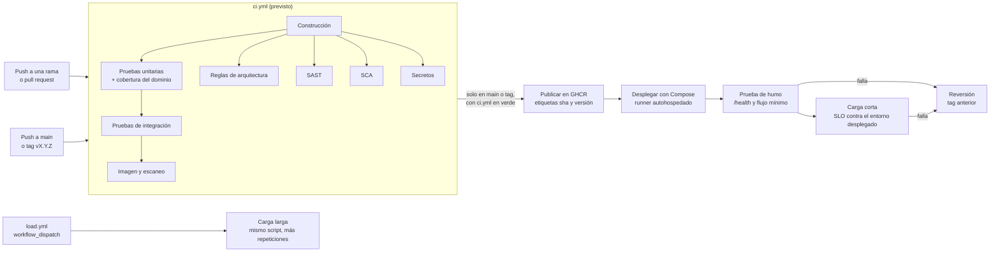

# Pipeline de entrega continua y segura

Este documento describe cómo se construye, verifica, publica y despliega Minecraft2: el diagrama del pipeline, qué hace cada etapa, qué umbral la detiene y por qué se eligió ese valor, y el procedimiento de reversión. Lo lee quien revisa o mantiene el pipeline. Los pasos para instalar y operar el sistema desde cero están en la [guía de implementación](implementacion.md); el modelo de amenazas y los controles de seguridad, en [seguridad.md](seguridad.md).

> **Estado del documento: esqueleto.** El pipeline aún no existe: no hay `.github/workflows/`. Cada elemento marcado «Previsto — responsable: Persona N» se completa con la ejecución real y el marcador se retira antes de la entrega. Aquí no se escribe ningún resultado, enlace de ejecución ni duración que no provenga de una ejecución de GitHub Actions.

Responsables: Persona 3 (despliegue, carga, reversión) con Persona 1 (integración continua, protección de `main`, versionado).

## 1. Diagrama del pipeline

Previsto — responsable: Persona 1 y Persona 3. El diagrama muestra el pipeline que se construirá; se ajusta a los jobs reales de `.github/workflows/ci.yml`, `.github/workflows/cd.yml` y `.github/workflows/load.yml` cuando existan.

- En un pull request corre solo `ci.yml`. Cada etapa es un check independiente del pull request y los checks son obligatorios en el ruleset de `main` (sección 4).
- En `main` o con un tag `vX.Y.Z` corre `cd.yml`, que solo publica y despliega si `ci.yml` terminó en verde.
- Ninguna etapa usa `continue-on-error`: una etapa que falla detiene el pipeline.

## 2. Etapas y umbrales

Las siete etapas son las del enunciado (sección 2.2). La columna «Estado» distingue lo que ya existe en el repositorio de lo que se construirá.

| Etapa | Qué verifica | Herramienta | Detiene el pipeline cuando… | Por qué ese valor | Estado |
| --- | --- | --- | --- | --- | --- |
| Construcción | Que el código compila con Java 17 y que las dependencias de [`pom.xml`](../pom.xml) se resuelven. | Maven (`mvn -B verify`) | No compila o no se resuelve una dependencia. | Sin un artefacto compilado no hay nada que probar ni desplegar. | Maven y el POM existen. El job de Actions: Previsto — responsable: Persona 1. |
| Pruebas unitarias | Las reglas de negocio aisladas del Corte 2: dominio, adaptadores aislados y métricas, sin disco ni red. | Surefire (excluye `integration.test.patterns` del POM) y JaCoCo sobre `domain/**` | Falla una prueba, o la cobertura de **líneas** del dominio es menor que **70 %**. | 70 % es el mínimo del enunciado. La referencia del Corte 2 es 887/984 líneas, 90,14 % ([pruebas](pruebas.md#cobertura-del-dominio)), de modo que el umbral deja margen; subirlo es una decisión del equipo, no un requisito. Conjunto de datos del umbral (solo unitarias, sin sumar con integración): Previsto — responsable: Persona 1. | Pruebas y reporte JaCoCo existen. El gate `check` de JaCoCo en el POM no existe todavía: Previsto — responsable: Persona 1. |
| Pruebas de integración | Las fronteras con infraestructura real o embebida: archivos JSON en directorios temporales, el JAR por consola y, en el Corte 3, el servidor. | Failsafe (incluye `integration.test.patterns`) | Falla una prueba. | Cualquier fallo en una frontera real invalida el cambio; no hay un porcentaje tolerable. Referencia del Corte 2: 148 casos sin fallos ([pruebas](pruebas.md#resultados-por-nivel)). | Pruebas existentes. Integración con el servidor: Previsto — responsable: Persona 2. |
| Reglas de arquitectura | Que se respeten las reglas de dependencias del [ADR-001](adr/ADR-001-estilo-recuperacion.md#5-decisión-implementada). | `ArchitectureBoundaryTest` (3 pruebas) | Se viola una regla de dependencias. | Las reglas protegen fronteras del estilo en capas: dominio sin capas superiores ni LibGDX, aplicación que solo usa `WorldStorage` de persistencia, entrada traducida sin callback. Cualquier violación es un cambio de arquitectura y requiere un ADR. | [`ArchitectureBoundaryTest`](../test/architecture/ArchitectureBoundaryTest.java) existe y hoy lo ejecuta Surefire (no figura en `integration.test.patterns`). Check propio en el pipeline y regla de la frontera de red: Previsto — responsable: Persona 2. |
| Análisis de seguridad | Código propio (SAST), dependencias (SCA) y secretos, incluido el historial. | Previsto — responsable: Persona 2 | Ver los umbrales literales en [seguridad.md](seguridad.md#3-controles-y-umbrales). | Son los mínimos del enunciado; se justifican en el [ADR-003](adr/ADR-003-seguridad.md). | Previsto — responsable: Persona 2. |
| Imagen y escaneo | Se construye la imagen Docker en el pipeline y se escanea. | Previsto — responsable: Persona 2 | Ninguna vulnerabilidad crítica con corrección disponible (mínimo del enunciado). | Igual que el control anterior. | El [`Dockerfile`](../Dockerfile) actual es multi-etapa, con bases de versión fija y cuenta `app` sin privilegios, pero es la imagen de consola del Corte 2 y no tiene `HEALTHCHECK`. Dockerfiles definitivos: Previsto — responsable: Persona 3. |
| Despliegue y verificación | Que el sistema desplegado responde (humo) y cumple el SLO (carga corta). | Compose en runner autohospedado, script de humo y script de carga en `perf/` | Falla el humo, o la carga incumple un umbral (código de salida distinto de cero). | Ver SLO a continuación. | Previsto — responsable: Persona 3. |

### Umbrales del SLO en el despliegue

| SLO | Umbral | Por qué ese valor | Estado |
| --- | --- | --- | --- |
| SLO-CARGA-01 | 80 zombis activos, p95 del tick de IA ≤ 16,67 ms, 0 ticks fallidos y 0 ticks con déficit de población, en cada una de tres repeticiones. | 16,67 ms es el presupuesto de un fotograma a 60 FPS; 80 zombis es el objetivo experimental fijado por el protocolo antes de medir ([carga.md §2](recuperacion-c2/carga.md#2-slo-fijado-antes-de-ejecutar)). | Valores del Corte 2, medidos con un harness dentro de la JVM. Medirlos contra el servidor desplegado (por ejemplo, leyendo la duración del tick desde `/metrics`) es una adaptación del protocolo que debe quedar documentada y confirmada con el profesor: Previsto — responsable: Persona 3. |
| SLO-RED-01 | p95 de ida y vuelta entrada → estado de un cliente hacia el servidor ≤ 50 ms y 0 errores. | Propuesta: 50 ms equivale a un periodo de tick a 20 Hz. Es un valor nuevo, no medido, sujeto a confirmación. | Propuesto: Previsto — responsable: Persona 3 (con Persona 1). |

El script de carga debe terminar con código distinto de cero si falta un resultado, si no se alcanzó la población objetivo o si se incumple cualquier umbral. Que el job falle con un umbral roto a propósito es parte de la evidencia: Previsto — responsable: Persona 3.

## 3. Requisitos del pipeline

### Caché y duración

- Caché de dependencias de Maven. Previsto — responsable: Persona 1.
- El pipeline de integración (sin contar despliegue ni carga) debe durar menos de 10 minutos. Las duraciones se registran de ejecuciones reales de Actions:

| Fecha | Ejecución | Duración del pipeline de integración | ¿Menos de 10 min? |
| --- | --- | --- | --- |

Previsto — responsable: Persona 1. La tabla se llena con ejecuciones reales; un tiempo de espera agotado no cuenta como cumplimiento.

### Artefactos de cada ejecución

Se publican también cuando una etapa falla. Previsto — responsable: Persona 1 (pruebas y cobertura), Persona 2 (seguridad) y Persona 3 (carga).

| Artefacto | Origen |
| --- | --- |
| Reportes de pruebas unitarias y de integración | Surefire y Failsafe (`target/`) |
| Cobertura del dominio, unitaria e integración por separado | JaCoCo, `target/site/jacoco-domain-unit` y `target/site/jacoco-domain-integration` |
| Reportes de seguridad (SAST, SCA, secretos, imagen) | Previsto — responsable: Persona 2 |
| Resultados de carga | `results.csv`, `console.txt` y `manifest.txt` de [`perf/`](../perf/README.md) |

### Badge

Badge de estado del pipeline en el README raíz. Previsto — responsable: Persona 1.

## 4. Flujo de ramas, pull request y protección de `main`

- Trabajo por ramas (GitHub Flow); nadie hace push directo a `main`.
- Regla de protección o ruleset de `main`: pull request obligatorio, aprobación de al menos otro integrante y todos los checks de la sección 2 en verde para fusionar.
- Cada cambio entra por pull request aprobado por otro integrante; el orden de integración y las ramas por integrante están en el [README raíz](../../README.md).
- Evidencia de la configuración efectiva (ruleset y pull requests aprobados): Previsto — responsable: Persona 1.
- Dependabot para mantener dependencias y acciones al día; no sustituye el control SCA. Previsto — responsable: Persona 1.

## 5. Versionado semántico y versiones

- Cada versión se marca con un tag `vMAJOR.MINOR.PATCH` (por ejemplo, `v1.0.0`) y sus cambios se describen en GitHub Releases y en `CHANGELOG.md`. Previsto — responsable: Persona 3.
- El cliente de escritorio (JAR) se genera en el pipeline y se publica en Releases con cada versión. Previsto — responsable: Persona 3.

| Versión | Fecha | Cambios | Imagen en el registro | Release |
| --- | --- | --- | --- | --- |

Previsto — responsable: Persona 3. Se llena con las versiones realmente publicadas.

## 6. Despliegue

Previsto — responsable: Persona 3 (con Persona 1). Contrato que el despliegue debe cumplir, según el enunciado (sección 5) y la decisión de [ADR-002](adr/ADR-002-despliegue.md):

- Registro: GitHub Container Registry. Cada imagen se etiqueta con el SHA del commit y, cuando hay tag, con la versión. **Nunca se despliega una imagen etiquetada solo como `latest`.**
- Entorno: Docker Compose en un runner autohospedado del equipo. El job que usa el runner autohospedado corre solo para `main` (o tags) y con un Environment de GitHub; el código de un pull request nunca corre en ese runner. El riesgo se analiza en [seguridad.md](seguridad.md#2-modelo-de-amenazas-stride).
- Imagen a desplegar: la variable `MC2_IMAGE_TAG` indica la etiqueta; el despliegue la fija al SHA o a la versión publicados.
- Secretos y variables del despliegue: en GitHub Secrets o en el Environment, nunca en el repositorio. Lista de nombres: Previsto — responsable: Persona 3.
- Orden tras desplegar: esperar el healthcheck (`/health`), ejecutar la prueba de humo y solo después la carga corta contra el entorno desplegado. Si alguna falla, el pipeline falla y se revierte.
- Carga larga: workflow `load.yml` con `workflow_dispatch` (y, opcionalmente, programación). No corre en cada push. Previsto — responsable: Persona 3.

## 7. Reversión

El objetivo es volver a la versión anterior desplegando de nuevo la imagen de su tag. Previsto — responsable: Persona 3. Se escribe y se prueba al menos una vez; la evidencia es la ejecución en GitHub Actions o la fila de la tabla de abajo.

| Paso | Qué se hace | Comando o acción | Resultado esperado |
| --- | --- | --- | --- |
| 1 | Identificar la versión previa estable (tag o SHA). | Previsto — responsable: Persona 3 | Previsto — responsable: Persona 3 |
| 2 | Fijar `MC2_IMAGE_TAG` a esa etiqueta y volver a levantar los servicios con Compose. | Previsto — responsable: Persona 3 | Previsto — responsable: Persona 3 |
| 3 | Esperar el healthcheck y ejecutar la prueba de humo. | Previsto — responsable: Persona 3 | `/health` responde y el humo pasa. |
| 4 | Registrar la reversión. | Previsto — responsable: Persona 3 | Fila agregada a la tabla siguiente. |

Reversiones ejecutadas (se llena solo con ejecuciones reales):

| Fecha | Versión de origen | Versión restaurada | Ejecución de Actions | Verificación |
| --- | --- | --- | --- | --- |

## 8. Etapas opcionales (bonificación)

Solo se inician con integración continua y despliegue continuo en verde. Previsto — responsable: Persona 3 (Kubernetes y observabilidad) y Persona 2 (DAST).

| Bonificación | Qué añade al pipeline |
| --- | --- |
| Kubernetes | Manifiestos en `k8s/` aplicados en kind, con probes, límites de recursos y una política justificada. |
| Observabilidad | Prometheus y Grafana sobre `/metrics` del servidor, en `observabilidad/`. |
| DAST | OWASP ZAP (baseline) contra el entorno desplegado, con hallazgos tratados como los de [seguridad.md](seguridad.md#4-registro-de-hallazgos). |
