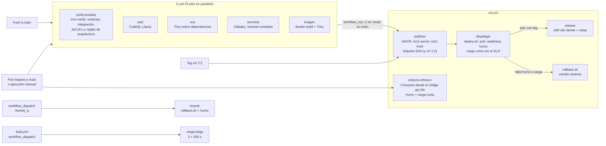

# Pipeline de entrega continua y segura

Este documento describe cómo se construye, verifica, publica y despliega Minecraft2: el diagrama del pipeline, qué hace cada etapa, qué umbral la detiene y por qué se eligió ese valor, y el procedimiento de reversión. Lo lee quien revisa o mantiene el pipeline. Los pasos para instalar y operar el sistema desde cero están en la [guía de implementación](implementacion.md); el modelo de amenazas y los controles de seguridad, en [seguridad.md](seguridad.md); la topología desplegada, en la [vista de despliegue](arquitectura.md#8-vista-de-despliegue).

> **Estado del documento.** El workflow de integración continua, `.github/workflows/ci.yml`, tuvo una ejecución completa en verde ([ejecución 43487176016](https://github.com/MarshallGomez1103/Mc2/actions/runs/43487176016), commit `b9f06d3`, pull request #1); tras fusionar ese pull request, la ejecución sobre `main` ([43736236291](https://github.com/MarshallGomez1103/Mc2/actions/runs/43736236291), commit `572b65b`) también pasó sus cinco jobs. El ruleset de `main` exige los cinco checks (sección 4) y dos de los controles tienen una demostración de bloqueo (sección 2). La entrega continua (`cd.yml`), la carga larga (`load.yml`), el despliegue y la reversión están definidos; sus ejecuciones se registran en las tablas de las secciones 2, 5, 6 y 7 a medida que ocurren. Aquí no se escribe ningún resultado, enlace de ejecución ni duración que no provenga de una ejecución real de GitHub Actions.

Responsables: Persona 3 (contenedores, entrega continua, despliegue, carga, reversión) con Persona 1 (integración continua, protección de `main`).

## 1. Diagrama del pipeline

Los nombres de los nodos son los ids de los jobs, que son también los nombres de los checks en GitHub.

- `ci.yml` se dispara en `pull_request` hacia `main`, en `push` a `main` y a demanda (`workflow_dispatch`). Una rama con un pull request abierto genera una sola ejecución de integración continua, la del pull request. Los cinco jobs no declaran dependencias entre sí (`needs`), de modo que el tiempo total es el del job más lento y no la suma.
- Cada job es un check independiente del pull request. Su identificador en el YAML es el nombre del check (`build-pruebas`, `sast`, `sca`, `secretos`, `imagen`), sin nombre personalizado; renombrar un job rompe la regla del ruleset que lo exija. El ruleset de `main` exige esos cinco checks (sección 4).
- Permisos del workflow: `contents: read` y nada más. El resultado de CodeQL se conserva como artefacto y no se sube a la pestaña Security, por lo que no se necesita `security-events: write`.
- Cada job tiene `timeout-minutes` (10 o 15). Una ejecución de pull request se cancela cuando llega un push nuevo a la misma rama; las ejecuciones de `main` nunca se cancelan.
- Las acciones de terceros están fijadas por SHA completo de commit, con la versión como comentario: `actions/checkout` v7.0.1, `actions/setup-java` v6.2.0, `actions/upload-artifact` v7.0.2 y `github/codeql-action` v4.39.3. Trivy 0.76.2 y Gitleaks 8.30.1 se descargan en cada ejecución con verificación de suma SHA-256 y no se instalan en el runner de forma permanente.
- En un pull request corre además el job `entorno-efimero` de `cd.yml`, que levanta Compose desde el código del pull request y ejecuta el humo y la carga corta.
- `cd.yml` publica y despliega solo cuando `ci.yml` terminó en verde para un push a `main` (disparador `workflow_run`); despliega exactamente el SHA que `ci.yml` probó (`workflow_run.head_sha`), no la punta de `main` en ese momento.
- Un tag `vX.Y.Z` reutiliza la imagen ya verificada de su SHA (la reetiqueta con `docker buildx imagetools create`), la despliega con el mismo humo y la misma carga y solo entonces publica la Release.
- Ninguna etapa usa `continue-on-error`: una etapa que falla detiene el pipeline. El job `desplegar` falla aunque la reversión funcione, para que el fallo quede visible.

## 2. Etapas y umbrales

Las etapas son las del enunciado (sección 2.2); el análisis de seguridad se separa en SAST, SCA y secretos porque cada uno es un job. Las filas con job son las de `ci.yml` y cada una indica en «Estado» el resultado de la ejecución enlazada; la columna distingue lo que ya existe y pasó de lo que se construirá.

| Etapa | Qué verifica | Herramienta | Detiene el pipeline cuando… | Por qué ese valor | Estado |
| --- | --- | --- | --- | --- | --- |
| Construcción (job `build-pruebas`) | Que el código compila con Java 17 y que las dependencias de [`pom.xml`](../pom.xml) se resuelven. | Maven (`mvn -B -ntp verify`, Java 17 Temurin, caché de Maven) | No compila o no se resuelve una dependencia. | Sin un artefacto compilado no hay nada que probar ni desplegar. Java 17 es la versión del POM y del [`Dockerfile`](../Dockerfile), de modo que el pipeline prueba el mismo entorno que se entrega. | Implementado: pasa en 39 s ([ejecución](https://github.com/MarshallGomez1103/Mc2/actions/runs/43487176016)). |
| Pruebas unitarias (job `build-pruebas`) | Las reglas de negocio aisladas del Corte 2: dominio, adaptadores aislados y métricas, sin disco ni red. | Surefire (excluye `integration.test.patterns` del POM) y JaCoCo sobre `domain/**` | Falla una prueba, o la cobertura de **líneas** de `domain/**`, medida solo con pruebas unitarias (`jacoco-unit.exec`), es menor que **70 %**. | 70 % es el mínimo del enunciado. Valor medido en local sobre `b9f06d3`: 92,68 % (912/984 líneas); la referencia del Corte 2 era 90,14 % ([pruebas](pruebas.md#cobertura-del-dominio)). El umbral deja margen; subirlo es una decisión del equipo, no un requisito. La cobertura de integración no se suma. | Implementado: 218 pruebas unitarias sin fallos y umbral cumplido en la [ejecución](https://github.com/MarshallGomez1103/Mc2/actions/runs/43487176016). Bloqueo demostrado en Actions con el umbral en 0,99 (pull request de demostración #4, [ejecución 43736947725](https://github.com/MarshallGomez1103/Mc2/actions/runs/43736947725)); también se comprobó en local con 0,95: «Coverage checks have not been met». |
| Pruebas de integración (job `build-pruebas`) | Las fronteras con infraestructura real o embebida: archivos JSON en directorios temporales, el JAR por consola y, en el Corte 3, el servidor. | Failsafe (incluye `integration.test.patterns`), dentro de `mvn verify` | Falla una prueba. | Cualquier fallo en una frontera real invalida el cambio; no hay un porcentaje tolerable. | Implementado: 148 pruebas sin fallos en la [ejecución](https://github.com/MarshallGomez1103/Mc2/actions/runs/43487176016). Integración con el servidor: `GameServerIT`, `MultiplayerServerIT` y `NetworkClientIT` (Persona 2) y `NetworkLoadClientIT` (Persona 3) corren en el mismo job. |
| Reglas de arquitectura (job `build-pruebas`) | Que se respeten las reglas de dependencias del [ADR-001](adr/ADR-001-estilo-recuperacion.md#5-decisión-implementada). | [`ArchitectureBoundaryTest`](../test/architecture/ArchitectureBoundaryTest.java) (14 pruebas: 3 reglas de capas y los casos que comprueban que el escáner detecta importaciones con sangría, con nombre completo, comodín, estáticas y partidas en varias líneas) | Se viola una regla de dependencias, o el informe de la clase falta o no contiene pruebas. | Las reglas protegen fronteras del estilo en capas: dominio sin capas superiores ni LibGDX, aplicación que solo usa `WorldStorage` de persistencia, entrada traducida sin callback. Cualquier violación es un cambio de arquitectura y requiere un ADR. | Implementado: la ejecuta Surefire dentro de `build-pruebas`; no es un job aparte. Regla de la frontera de red: la añade la Persona 2 (ADR-004, pull request #15). |
| SAST (job `sast`) | Vulnerabilidades en el código propio de `Minecraft2/`. | CodeQL para Java con compilación manual (`mvn compile`) y [`scripts/umbral-sast.sh`](../../scripts/umbral-sast.sh), que lee el SARIF | Un hallazgo con puntuación de severidad de seguridad ≥ 7,0 (alto o crítico) sin excepción registrada en [seguridad.md](seguridad.md#4-registro-de-hallazgos), o un análisis que extrajo cero archivos Java. | Mínimo del enunciado ([seguridad.md](seguridad.md#3-controles-y-umbrales), [ADR-003](adr/ADR-003-seguridad.md)). CodeQL solo publica alertas: sin el paso que interpreta el SARIF el job no bloquearía nada. La cuenta de archivos extraídos evita un verde vacío cuando el análisis no encuentra código. | Implementado: pasa en 1 min 57 s, con 90 archivos Java extraídos y 0 hallazgos altos o críticos ([ejecución](https://github.com/MarshallGomez1103/Mc2/actions/runs/43487176016)). |
| SCA (job `sca`) | Librerías con vulnerabilidades conocidas en `Minecraft2/`. | Trivy 0.76.2 (`fs`) sobre `pom.xml`, con [`scripts/sca.sh`](../../scripts/sca.sh) | Una vulnerabilidad HIGH o CRITICAL con corrección disponible (`--ignore-unfixed`), o un informe sin ningún resultado de tipo `pom`. | Mínimo del enunciado. Las vulnerabilidades sin corrección no se resuelven actualizando y se revisan en el registro de hallazgos. La comprobación del resultado `pom` impide que el job pase sin haber analizado nada. | Implementado: pasa en 28 s, sin vulnerabilidades que bloqueen ([ejecución](https://github.com/MarshallGomez1103/Mc2/actions/runs/43487176016)). |
| Secretos (job `secretos`) | Contraseñas, tokens y llaves en el código y en todo el historial. | Gitleaks 8.30.1 con [`scripts/secretos.sh`](../../scripts/secretos.sh), con `fetch-depth: 0` en el checkout | Cualquier hallazgo: el umbral es cero. También falla en un clon superficial o sin commits. | Mínimo del enunciado: cero secretos, incluido el historial. Sin historial completo el escaneo vería solo el último commit y parecería verde. La salida no usa `--verbose`, para que los correos de los commits no lleguen al registro. | Implementado: pasa en 6 s con 61 commits alcanzables desde todas las referencias y sin hallazgos ([ejecución](https://github.com/MarshallGomez1103/Mc2/actions/runs/43487176016)). |
| Imagen y escaneo (job `imagen`) | Se construye la imagen del servidor ([`Dockerfile`](../Dockerfile)) como `mc2-server:ci` y se escanea el resultado. | [`scripts/escaneo-imagen.sh`](../../scripts/escaneo-imagen.sh): `docker build`, `docker save` y Trivy 0.76.2 (`image --input`) | Una vulnerabilidad CRITICAL con corrección disponible. | Mínimo del enunciado. El escáner lee el archivo guardado de la imagen; no se monta el socket de Docker en ningún contenedor. El build de la imagen solo empaqueta el JAR (`mvn package -DskipTests -DskipUnitTests=true`): las pruebas y el umbral de cobertura los verifica `build-pruebas`, y no se repiten dentro de `docker build`. | Implementado: pasa en 1 min 42 s ([ejecución](https://github.com/MarshallGomez1103/Mc2/actions/runs/43487176016)). Imágenes: [`Dockerfile`](../Dockerfile) (`mc2-server`) y [`Dockerfile.front`](../Dockerfile.front) (`mc2-front`), multi-etapa, bases de versión fija (`maven:3.9.16-eclipse-temurin-17-noble` y `eclipse-temurin:17.0.21_9-jre-noble`), usuario `app` (uid 10001) y `HEALTHCHECK`. |
| Despliegue y verificación | Que el sistema desplegado arranca, responde (humo) y cumple el SLO (carga corta). | `scripts/deploy.sh` (Compose: `pull`, `up --wait`, humo) y `perf/run-slo.sh` (`NetworkLoadClient` + `LoadSloGate`) | Readiness: algún servicio no queda saludable en 180 s. Humo: `/health` ≠ 200, falta una de las cinco métricas del contrato en `/metrics`, el `hello` al 7777 no recibe `welcome` en 5 s o noVNC no responde. Carga: cualquier incumplimiento del SLO (tabla siguiente), falta de un resultado o población no alcanzada. | El humo comprueba cada frontera desplegada (HTTP de operación, protocolo de juego y front) con un tiempo acotado; la carga aplica el SLO fijado antes de medir. | `cd.yml` (jobs `entorno-efimero` y `desplegar`) y `load.yml`. |

Las ejecuciones del pull request #1 y de `main` demuestran que los cinco jobs pasan sobre un cambio limpio. Dos controles tienen además una demostración de bloqueo en Actions, con pull requests de demostración cerrados sin fusionar y sus ramas eliminadas ([evidencia en seguridad.md](seguridad.md#5-evidencia-pull-request-bloqueado)):

- **Cobertura (`build-pruebas`).** El pull request #4 subió el umbral de cobertura de líneas del dominio a 0,99. En la [ejecución 43736947725](https://github.com/MarshallGomez1103/Mc2/actions/runs/43736947725), `build-pruebas` e `imagen` fallaron con «lines covered ratio is 0.92, but expected minimum is 0.99», que es la regla `unit-domain-check` de JaCoCo; `imagen` falló por la misma causa porque el `docker build` de entonces repetía las pruebas unitarias y el umbral. En esa ejecución `secretos` también falló, pero solo porque la rama de la otra demostración existía a la vez en el remoto y el control escanea todas las ramas: no cuenta como evidencia de la cobertura.
- **Secretos (`secretos`).** El pull request #5 añadió una credencial falsa en un archivo de configuración de demostración. En la [ejecución 43736948906](https://github.com/MarshallGomez1103/Mc2/actions/runs/43736948906), `secretos` falló con «Secrets gate FAILED (gitleaks rc=1)» y un hallazgo, y los otros cuatro jobs pasaron.

Siguen sin demostrar: una dependencia vulnerable para `sca`, un hallazgo alto para `sast`, una imagen con una vulnerabilidad crítica para `imagen` (en la ejecución anterior la imagen falló por la cobertura, no por una vulnerabilidad) y una infracción de las reglas de arquitectura. Previsto — responsable: Persona 2.

### Umbrales del SLO en el despliegue

El gate es [`LoadSloGate`](../test/loadtest/LoadSloGate.java) y su prueba es [`LoadSloGateTest`](../test/loadtest/LoadSloGateTest.java). El cliente [`NetworkLoadClient`](../test/loadtest/NetworkLoadClient.java) conecta 3 clientes del protocolo v1 (uno por apariencia), envía entradas al ritmo del tick y lee `/metrics` antes y después de cada repetición. Sale con código distinto de cero si falta una repetición o una medición, si no se alcanzó la población o si se incumple cualquier umbral, e informa todos los incumplimientos, no solo el primero.

| SLO | Umbral (en cada una de tres repeticiones) | Cómo se mide contra el servidor | Por qué ese valor |
| --- | --- | --- | --- |
| SLO-CARGA-01 | 80 zombis activos (mínimo de `mc2_zombies_active` durante la repetición), p95 del tick ≤ 16,67 ms, 0 ticks fallidos y 0 ticks con déficit de población. | p95 del histograma `mc2_tick_duration_seconds` sobre la diferencia entre la lectura inicial y la final de la repetición, interpolado como `histogram_quantile` de PromQL ([`PrometheusSnapshot`](../test/loadtest/PrometheusSnapshot.java)); incrementos de `mc2_tick_failures_total` y `mc2_population_deficit_ticks_total`. | 16,67 ms es el presupuesto de un fotograma a 60 FPS y 80 zombis es el objetivo fijado antes de medir en el Corte 2 ([carga.md §2](recuperacion-c2/carga.md#2-slo-fijado-antes-de-ejecutar)). Cambia el lugar de la medición (servidor desplegado en lugar de un harness dentro de la JVM); el umbral no cambia. Pendiente de confirmación con el profesor. |
| SLO-RED-01 | p95 de ida y vuelta entrada → estado ≤ 100 ms y 0 errores de red. | Desde que un cliente envía `input{seq}` hasta que recibe el primer `state` que la reconoce (campo `ack`; sin él, el siguiente `state`). | Definido por el equipo: 100 ms son dos periodos de tick a 20 Hz. A 20 Hz una entrada espera en promedio medio tick hasta el siguiente `state`, así que el p95 de la espera sola ronda 47,5 ms; un umbral de 50 ms no deja margen para la red ni para el procesamiento. Contra un doble del servidor que emite a 20 Hz, el p95 medido fue 52,4 ms (local, 15-11-2026), por encima de 50 ms: de ahí que el umbral sea de dos ticks. Contra el servidor real, en el entorno efímero del pull request #2 ([ejecución 43996138039](https://github.com/MarshallGomez1103/Mc2/actions/runs/43996138039)), el p95 fue de 52,2 a 53,4 ms con 3 clientes y 80 zombis: cumple con margen y confirma que la espera hasta el siguiente tick domina la medida. |

Variables de la carga (además de las del contrato común): `MC2_LOAD_CLIENTS` (3), `MC2_LOAD_REPETITIONS` (3), `MC2_LOAD_SECONDS` (30 en la carga corta, 300 en la larga), `MC2_LOAD_WARMUP_SECONDS` (60, tiempo máximo de espera hasta alcanzar la población), `MC2_LOAD_CLIENT_WARMUP_SECONDS` (30, calentamiento con los clientes ya conectados enviando entradas; sus muestras se descartan antes de la lectura inicial de `/metrics`) y `MC2_LOAD_OUT`. Esperar la población no calienta el servidor: con los 80 zombis ya presentes la espera termina enseguida, y en frío hubo ticks lentos por el cálculo de rutas y pausas de recolección de basura, por eso el calentamiento con clientes es una variable aparte. Para demostrar que el job falla con un umbral roto se usa `MC2_SLO_TICK_P95_MS` o `MC2_SLO_RTT_P95_MS` (por ejemplo, `MC2_SLO_TICK_P95_MS=0.5`). Cada corrida deja `manifest.txt` (SHA, etiqueta de imagen, parámetros, runner), `console.txt`, `results.csv` (una fila por repetición) y `verdict.txt`, publicados como artefacto `carga-<etiqueta>`.

Prueba del script sin el servidor real: [`NetworkLoadClientIT`](../test/loadtest/NetworkLoadClientIT.java) lo ejecuta contra un doble del servidor que habla el protocolo v1 y expone `/metrics` (cumple; umbral roto a propósito → código 1; población insuficiente → código 1; servidor inalcanzable → código 1). No sustituye la carga contra el entorno desplegado.

Ejecuciones de la carga contra el entorno desplegado (se llena solo con ejecuciones reales):

| Fecha | Ejecución de Actions | Etiqueta | p95 del tick (rep. 1/2/3) | p95 ida y vuelta (rep. 1/2/3) | Veredicto |
| --- | --- | --- | --- | --- | --- |
| 2026-11-16 | [44003697043](https://github.com/MarshallGomez1103/Mc2/actions/runs/44003697043), job `desplegar` (runner autohospedado `mc2-wsl`) | `6401c84` | 74,907 / 49,982 / 70,179 ms | 233,060 / 114,364 / 425,679 ms | Incumple: SLO-CARGA-01 y SLO-RED-01; en la repetición 3 solo 1 de 3 clientes y 2 errores de red. Ese mismo equipo compilaba otra imagen durante la carga. |
| 2026-11-16 | [44005663312](https://github.com/MarshallGomez1103/Mc2/actions/runs/44005663312), intento 1, job `desplegar` (runner autohospedado `mc2-wsl`) | `9d44297` | 46,572 / 85,000 / 45,742 ms | 84,599 / 164,145 / 153,427 ms | Incumple SLO-CARGA-01 en las tres repeticiones y SLO-RED-01 en dos; el job revirtió a `6401c84` (sección 7). |
| 2026-11-16 | [44005663312, intento 2](https://github.com/MarshallGomez1103/Mc2/actions/runs/44005663312/attempts/2), job `desplegar` (runner hospedado de GitHub) | `9d44297` | 14,819 / 7,160 / 11,028 ms | 60,828 / 54,907 / 57,815 ms | Cumple: 3 clientes, mínimo de 80 zombis, 0 ticks fallidos, 0 de déficit y 0 errores de red. |
| 2026-11-16 | [43996138039](https://github.com/MarshallGomez1103/Mc2/actions/runs/43996138039), job `entorno-efimero` (pull request #2, runner hospedado) | Imágenes construidas desde `12a3f6c` | 12,459 / 3,909 / 3,716 ms (601–602 ticks) | 53,411 / 52,203 / 52,496 ms (≈1 800 muestras) | Cumple: 3 clientes, mínimo de 80 zombis, 0 ticks fallidos, 0 de déficit y 0 errores de red. Humo correcto antes de la carga. |
| 2026-11-16 | [44010178347](https://github.com/MarshallGomez1103/Mc2/actions/runs/44010178347), `load.yml` (carga larga, 3 × 300 s, runner hospedado) | `9d44297` | 17,175 / 17,043 / 16,647 ms (≈6 000 ticks) | 59,294 / 66,346 / 65,939 ms (≈18 000 muestras) | Incumple SLO-CARGA-01 por poco en las repeticiones 1 y 2 (17,2 y 17,0 ms frente a 16,67 ms); SLO-RED-01 se cumple; 0 ticks fallidos, 0 de déficit y 0 errores de red. Con carga sostenida de 5 minutos el tick queda en el límite del presupuesto de 60 FPS en un runner de 4 vCPU que también ejecuta el front con OpenGL por software. El umbral no se cambia. |
| 2026-11-16 | [44012999859](https://github.com/MarshallGomez1103/Mc2/actions/runs/44012999859), job `desplegar` del tag (runner hospedado) | `v1.0.0` | 10,492 / 3,776 / 6,072 ms | 52,153 / 52,275 / 54,390 ms | Cumple: 3 clientes, mínimo de 80 zombis, 0 ticks fallidos, 0 de déficit y 0 errores de red. |

## 3. Requisitos del pipeline

### Caché y duración

- Caché de dependencias de Maven con `actions/setup-java` (`cache: maven`, clave calculada sobre `Minecraft2/pom.xml`) en los tres jobs que usan Maven: `build-pruebas`, `sast` y `sca`.
- El pipeline de integración (sin contar despliegue ni carga) debe durar menos de 10 minutos. Los jobs corren en paralelo. Las duraciones se registran de ejecuciones reales de Actions:

| Fecha | Ejecución | Duración del pipeline de integración | ¿Menos de 10 min? |
| --- | --- | --- | --- |
| 2026-11-13 | [43487176016](https://github.com/MarshallGomez1103/Mc2/actions/runs/43487176016) (pull request #1, commit `b9f06d3`) | Unos 2 min en total; por job: `build-pruebas` 39 s, `sast` 1 min 57 s, `sca` 28 s, `secretos` 6 s, `imagen` 1 min 42 s | Sí |

La tabla se llena solo con ejecuciones reales; un tiempo de espera agotado no cuenta como cumplimiento.

### Artefactos de cada ejecución

Cada job de `ci.yml` publica su artefacto con `actions/upload-artifact`. Los de `build-pruebas`, `sast`, `sca` e `imagen` se publican también cuando el job falla (`if: always()`) y se conservan 14 días. El de `secretos` solo se publica si el job falla y se conserva 7 días, porque el informe de Gitleaks incluye autor y correo de cada commit señalado. Los resultados de carga de `cd.yml` y `load.yml` se publican también si la carga falla.

| Artefacto | Origen |
| --- | --- |
| `reportes-pruebas`: reportes de pruebas unitarias y de integración, y cobertura del dominio | Surefire y Failsafe (`Minecraft2/target/surefire-reports`, `Minecraft2/target/failsafe-reports`) y JaCoCo (`Minecraft2/target/site/`, con `jacoco-domain-unit` y `jacoco-domain-integration` por separado) |
| `sarif-codeql` | Resultado de CodeQL en formato SARIF (job `sast`) |
| `reporte-sca` | `reportes/trivy-dependencias.json`, informe de Trivy con todas las severidades (job `sca`) |
| `reporte-secretos` | `reportes/gitleaks.json`, solo si el job falla (job `secretos`) |
| `reporte-imagen` | `reportes/trivy-imagen.json`, informe de Trivy sobre la imagen (job `imagen`) |
| Resultados de carga | `manifest.txt`, `console.txt`, `results.csv` y `verdict.txt` de [`perf/run-slo.sh`](../perf/run-slo.sh): artefacto `carga-<etiqueta>` de `cd.yml` y `carga-larga-<etiqueta>-<ejecución>` de `load.yml`, también si la carga falla. |

El job `build-pruebas` escribe además el porcentaje de cobertura de líneas del dominio en el resumen de la ejecución.

### Cómo leer un fallo

En la pestaña Actions se abre la ejecución, el job en rojo y su primer paso con error; los artefactos traen los informes completos. El mismo `mvn -B -ntp verify` se reproduce en local, con JDK 17, desde `Minecraft2/`.

| Job | Qué se ve | Qué hacer |
| --- | --- | --- |
| `build-pruebas` | `Tests run: …, Failures: …` de Surefire o Failsafe, o el mensaje que nombra la dependencia prohibida de `ArchitectureBoundaryTest`. | Corregir el código o la prueba. La regla de arquitectura no se desactiva: se corrige la dependencia o se registra un ADR. |
| `build-pruebas` (cobertura) | `Coverage checks have not been met`, o un paso de comprobación que falla con `Falta target/jacoco-unit.exec`, `La ejecución unit-domain-check no aparece en el log` o `JaCoCo omitió una comprobación`. | Añadir pruebas unitarias en `domain/**` (la cobertura de integración no cuenta) y confirmar que no se saltaron las pruebas unitarias: sin `jacoco-unit.exec` JaCoCo omite el control. |
| `sast` | `QUALITY GATE DE SAST FALLIDO` con regla, archivo y línea, o `CodeQL no extrajo ningún archivo Java`. | Corregir el hallazgo o registrar una excepción en [seguridad.md](seguridad.md#4-registro-de-hallazgos). Si no se extrajeron archivos, el análisis apunta al directorio equivocado. |
| `sca` | `SCA gate FAILED` y la tabla de Trivy con la dependencia, la versión instalada y la corregida. | Actualizar la dependencia en [`pom.xml`](../pom.xml) a la versión corregida. |
| `secretos` | `Secrets gate FAILED`; el detalle está en el artefacto `reporte-secretos` (valores enmascarados). | Revocar y rotar el secreto primero: borrarlo del código no lo invalida, porque queda en el historial. Reescribir el historial es una decisión del equipo. |
| `imagen` | Tabla de Trivy con el paquete y la versión corregida, o un fallo de pruebas dentro de `docker build`. | Actualizar la imagen base del [`Dockerfile`](../Dockerfile) o la dependencia afectada; un fallo de pruebas se lee como en `build-pruebas`. |

### Badge

Badge de estado del pipeline en el [README raíz](../../README.md), enlazado al workflow `ci.yml` y a la rama `main`.

## 4. Flujo de ramas, pull request y protección de `main`

- Trabajo por ramas (GitHub Flow); nadie hace push directo a `main`.
- Ruleset de `main` (`proteger-main`, activo, consultado con la API de GitHub el 15 de noviembre de 2026): se aplica a la rama por defecto y exige pull request con al menos una aprobación, los cinco checks de `ci.yml` con esos nombres exactos (`build-pruebas`, `sast`, `sca`, `secretos` e `imagen`), historial sin reescrituras forzadas y sin borrado de la rama. No tiene actores con excepción, de modo que nadie hace push directo a `main`. No exige que la rama esté al día con `main` antes de fusionar, y descarta las aprobaciones cuando entra un push nuevo al pull request.
- Cada cambio entra por pull request aprobado por otro integrante; el orden de integración y las ramas por integrante están en el [README raíz](../../README.md).
- Evidencia: el [pull request #1](https://github.com/MarshallGomez1103/Mc2/pull/1) lo aprobó otro integrante antes de fusionarlo; la ejecución de `main` posterior pasó los cinco checks ([43736236291](https://github.com/MarshallGomez1103/Mc2/actions/runs/43736236291)).
- Dependabot para mantener dependencias y acciones al día; no sustituye el control SCA. El archivo `.github/dependabot.yml` está en `main` desde el [pull request #3](https://github.com/MarshallGomez1103/Mc2/pull/3).

## 5. Versionado semántico y versiones

- Cada versión se marca con un tag `vMAJOR.MINOR.PATCH` sobre un commit de `main` que ya pasó `ci.yml` y `cd.yml`. Sus cambios se describen en [`CHANGELOG.md`](../../CHANGELOG.md); el job `release` toma las notas de la sección `## [X.Y.Z]` y no publica la Release si esa sección falta.
- Cada imagen se publica con la etiqueta del SHA completo del commit y, con un tag, con `vX.Y.Z`. Las imágenes de `main` llevan la etiqueta OCI `org.opencontainers.image.version=0.0.0-<sha corto>`; las de un tag, la versión.
- La Release incluye el JAR del cliente (`minecraft2-vX.Y.Z.jar`) y su suma SHA-256, para descargarlo y conectarse al servidor desplegado.
- Para publicar una versión: actualizar `CHANGELOG.md` en un pull request, fusionarlo y, con `main` en verde, `git tag v1.0.0 <sha>` y `git push origin v1.0.0`.

Versiones publicadas (se llena con las realmente publicadas):

| Versión | Fecha | Commit | Imágenes en GHCR | Release |
| --- | --- | --- | --- | --- |
| `v1.0.0` | 2026-11-16 | `9823228` | `ghcr.io/marshallgomez1103/mc2-server:v1.0.0` y `mc2-front:v1.0.0`, reetiquetadas desde la imagen ya verificada de `9823228` ([44012999859](https://github.com/MarshallGomez1103/Mc2/actions/runs/44012999859)) | [v1.0.0](https://github.com/MarshallGomez1103/Mc2/releases/tag/v1.0.0): `minecraft2-v1.0.0.jar` y su `.sha256`, notas de `CHANGELOG.md` |

## 6. Despliegue

| Elemento | Valor |
| --- | --- |
| Registro | GitHub Container Registry: `ghcr.io/marshallgomez1103/mc2-server` y `ghcr.io/marshallgomez1103/mc2-front`. **Nunca se despliega `latest`**: `scripts/deploy.sh` rechaza toda etiqueta que no sea un SHA de 40 caracteres o `vX.Y.Z`. |
| Entorno | Docker Compose ([`docker-compose.yml`](../../docker-compose.yml)) en el runner del job `desplegar`. El runner sale de la variable de repositorio `MC2_DEPLOY_RUNNER`; sin ella, `ubuntu-latest`, un runner hospedado efímero que verifica el despliegue completo pero no queda encendido después del job. Se probó un runner autohospedado (`mc2-wsl`, etiqueta `mc2-deploy`) en el equipo de la Persona 3: Ubuntu 24.04 en WSL2 con Docker Desktop, servicio de systemd en `~/mc2-runner` y Maven 3.9.9 en su `PATH`. Desplegó y pasó el humo, pero incumplió el SLO en dos ejecuciones (tabla de despliegues): en ese equipo el front dibuja con OpenGL por software y ocupa unos 2,6 núcleos, que le quita al servidor, y el equipo comparte la CPU con otros contenedores. Los umbrales no se cambiaron: el equipo retiró la variable el 16-11-2026 y `desplegar` corre en un runner hospedado, donde el mismo SHA cumple. El runner sigue registrado; volver a usarlo exige un equipo dedicado o detener el front durante la carga, con una nueva medición. |
| Aislamiento del runner | El job `desplegar` existe solo para `main` tras `ci.yml` en verde, para tags y para la reversión manual. El código de un pull request corre en `entorno-efimero`, siempre en un runner hospedado. El riesgo del runner autohospedado está en [seguridad.md](seguridad.md#2-modelo-de-amenazas-stride). |
| Imagen a desplegar | `MC2_IMAGE_TAG`, que `cd.yml` fija al SHA verificado o a la versión. |
| Secretos | Ninguno propio: GHCR se usa con el `GITHUB_TOKEN` efímero del job (`packages: write` solo en `publicar`, `packages: read` en el despliegue y `contents: write` solo en `release`). En los jobs del runner de despliegue, `docker login` guarda la credencial en `DOCKER_CONFIG=$RUNNER_TEMP/docker-config`, que el runner borra al terminar, y no en el almacén de credenciales del equipo. `.env.example` no contiene secretos y `.env` no se versiona. |
| Variables de repositorio | `MC2_DEPLOY_RUNNER` (opcional): etiqueta de un runner autohospedado para `desplegar`, `revertir` y `carga-larga`. Hoy no está definida, así que esos jobs usan `ubuntu-latest`. Solo la puede crear el dueño del repositorio. |
| Orden tras desplegar | 1) `docker compose pull`; 2) `docker compose up -d --no-build --wait` con 180 s de límite (readiness por los healthchecks); 3) humo (`scripts/deploy.sh`); 4) carga corta (`perf/run-slo.sh corta`, 3 × 30 s con 80 zombis); 5) nuevo `scripts/deploy.sh` de la misma etiqueta con `MC2_LOAD_ZOMBIES=0`, para que el entorno que queda encendido sea el de juego y no el de carga. Antes del paso 1 se comprueba que el runner tiene Maven (`mvn -v`). Si algún paso falla, el job falla y se revierte. |
| Carga larga | [`load.yml`](../../.github/workflows/load.yml), `workflow_dispatch` con la etiqueta, la duración y la población; mismo script y mismos umbrales, 3 × 300 s. Al terminar vuelve a desplegar la etiqueta con `MC2_LOAD_ZOMBIES=0`. |
| Mecanismo de acceso | El entorno del runner hospedado vive solo mientras dura el job. Para usarlo se despliega la misma etiqueta verificada en un equipo con Docker, desde la raíz del repositorio: `scripts/deploy.sh <SHA o vX.Y.Z>` (readiness y humo incluidos). En ese equipo: `http://localhost:6080/vnc.html` (front en el navegador), `localhost:7777` (JAR del cliente) y `http://localhost:8080/health` y `/metrics`. Desde la red local, el JAR de la Release contra `<IP del anfitrión>:7777` (único puerto abierto a la red; el firewall de Windows debe permitirlo). noVNC no pide contraseña, por eso escucha solo en `127.0.0.1`; para mostrarlo a otro equipo de la misma red se levanta con `MC2_FRONT_BIND=0.0.0.0` durante la demostración y se vuelve al valor por defecto. Las imágenes de GHCR quedan ligadas al repositorio público; el despliegue las descarga con el `GITHUB_TOKEN` del job, y para que cualquiera pueda hacer `docker pull` sin iniciar sesión, el dueño del repositorio cambia la visibilidad de los paquetes `mc2-server` y `mc2-front` a pública tras la primera publicación. |

Despliegues ejecutados (se llena solo con ejecuciones reales):

| Fecha | Ejecución de Actions | Etiqueta | Runner | Humo | Carga |
| --- | --- | --- | --- | --- | --- |
| 2026-11-16 | [44003697043](https://github.com/MarshallGomez1103/Mc2/actions/runs/44003697043) | `6401c84` | `mc2-wsl` (autohospedado) | Correcto | Incumple; sin versión anterior a la cual revertir (primer despliegue) |
| 2026-11-16 | [44005663312](https://github.com/MarshallGomez1103/Mc2/actions/runs/44005663312), intento 1 | `9d44297` | `mc2-wsl` (autohospedado) | Correcto | Incumple; reversión automática a `6401c84` verificada |
| 2026-11-16 | [44005663312, intento 2](https://github.com/MarshallGomez1103/Mc2/actions/runs/44005663312/attempts/2) | `9d44297` | Hospedado de GitHub (`ubuntu-latest`) | Correcto | Cumple; después vuelve a 0 zombis |
| 2026-11-16 | [44011740257](https://github.com/MarshallGomez1103/Mc2/actions/runs/44011740257) | `9823228` (bases de imagen nuevas) | Hospedado de GitHub | Correcto | Cumple |
| 2026-11-16 | [44012999859](https://github.com/MarshallGomez1103/Mc2/actions/runs/44012999859) (tag) | `v1.0.0` | Hospedado de GitHub | Correcto | Cumple; después se publica la Release |

## 7. Reversión

Volver a una versión anterior es desplegar de nuevo la imagen de su etiqueta, con la misma readiness y el mismo humo. `scripts/deploy.sh` solo registra una etiqueta como «última buena» (`~/.mc2-deploy/ultima-buena`) después de que pasa el humo, de modo que un despliegue fallido nunca reemplaza el destino de la reversión.

| Paso | Qué se hace | Comando o acción | Resultado esperado |
| --- | --- | --- | --- |
| 1 | Identificar la versión previa estable. | Automático: `~/.mc2-deploy/ultima-buena` en el runner; en un runner efímero, el tag `vX.Y.Z` anterior al commit (`git describe --tags --abbrev=0 <sha>^`). Manual: la etiqueta de la tabla de despliegues. | Una etiqueta SHA o `vX.Y.Z` publicada en GHCR. |
| 2 | Fijar `MC2_IMAGE_TAG` a esa etiqueta y volver a levantar los servicios. | Automático: paso «Revertir a la versión anterior» del job `desplegar` cuando falla el humo o la carga. Manual: Actions → `cd` → *Run workflow* con `revertir_a`, o `scripts/rollback.sh <etiqueta>` en el equipo anfitrión. | `docker compose up --wait` con los dos servicios saludables. |
| 3 | Verificar. | `scripts/rollback.sh` llama a `scripts/deploy.sh`: readiness y humo completos. | `/health` 200, métricas del contrato, `hello` → `welcome` y noVNC respondiendo; código de salida 0. |
| 4 | Registrar. | `~/.mc2-deploy/historial.tsv` y el resumen del job; fila en la tabla siguiente. | Reversión trazable a una ejecución de Actions. |

Reversiones ejecutadas (se llena solo con ejecuciones reales):

| Fecha | Versión de origen | Versión restaurada | Ejecución de Actions | Verificación |
| --- | --- | --- | --- | --- |
| 2026-11-16 | `9d44297` | `6401c84` | [44005663312](https://github.com/MarshallGomez1103/Mc2/actions/runs/44005663312), intento 1, paso «Revertir a la versión anterior» (automática, por incumplir la carga) | `scripts/rollback.sh` → humo correcto: «Reversión verificada: 6401c84… en servicio». |

## 8. Etapas opcionales (bonificación)

Solo se inician con integración continua y despliegue continuo en verde.

| Bonificación | Qué añade | Dónde |
| --- | --- | --- |
| Kubernetes | Manifiestos aplicados en kind, con probes, límites de recursos, `NetworkPolicy` y RBAC mínimo. | [`k8s/`](../../k8s/README.md) |
| Observabilidad | Prometheus y Grafana sobre `/metrics` del servidor, tablero del SLO y regla de alerta. | [`observabilidad/`](../../observabilidad/README.md) |
| DAST | OWASP ZAP (baseline) contra `/health` y el front del entorno desplegado (paso entregado por la persona 2 para `cd.yml`). | [seguridad.md](seguridad.md#4-registro-de-hallazgos) |
