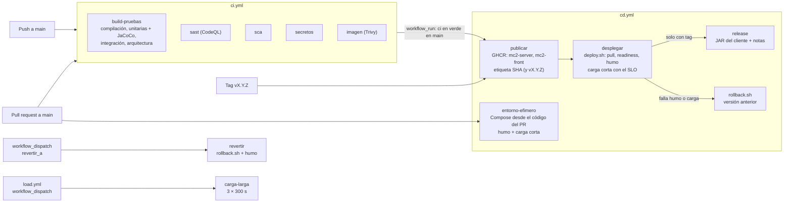

# Pipeline de entrega continua y segura

Este documento describe cómo se construye, verifica, publica y despliega Minecraft2: el diagrama del pipeline, qué hace cada etapa, qué umbral la detiene y por qué se eligió ese valor, y el procedimiento de reversión. Lo lee quien revisa o mantiene el pipeline. Los pasos para instalar y operar el sistema desde cero están en la [guía de implementación](implementacion.md); el modelo de amenazas y los controles de seguridad, en [seguridad.md](seguridad.md); la topología desplegada, en la [vista de despliegue](arquitectura.md#8-vista-de-despliegue).

> Aquí no se escribe ningún resultado, enlace de ejecución ni duración que no provenga de una ejecución real. Las tablas de ejecuciones, versiones y reversiones se llenan con enlaces a GitHub Actions a medida que ocurren.

Responsables: Persona 3 (contenedores, entrega continua, despliegue, carga, reversión) con Persona 1 (integración continua, protección de `main`).

## 1. Diagrama del pipeline

Los nombres de los nodos son los ids de los jobs, que son también los nombres de los checks en GitHub.

- En un pull request corren `ci.yml` y el job `entorno-efimero` de `cd.yml`. Cada job es un check independiente del pull request.
- `cd.yml` publica y despliega solo cuando `ci.yml` terminó en verde para un push a `main` (disparador `workflow_run`); despliega exactamente el SHA que `ci.yml` probó (`workflow_run.head_sha`), no la punta de `main` en ese momento.
- Un tag `vX.Y.Z` reutiliza la imagen ya verificada de su SHA (la reetiqueta con `docker buildx imagetools create`), la despliega con el mismo humo y la misma carga y solo entonces publica la Release.
- Ninguna etapa usa `continue-on-error`: una etapa que falla detiene el pipeline. El job `desplegar` falla aunque la reversión funcione, para que el fallo quede visible.

## 2. Etapas y umbrales

Las siete etapas son las del enunciado (sección 2.2). La columna «Estado» distingue lo que ya existe en el repositorio de lo que se construirá.

| Etapa | Qué verifica | Herramienta | Detiene el pipeline cuando… | Por qué ese valor | Estado |
| --- | --- | --- | --- | --- | --- |
| Construcción | Que el código compila con Java 17 y que las dependencias de [`pom.xml`](../pom.xml) se resuelven. | Maven (`mvn -B verify`) | No compila o no se resuelve una dependencia. | Sin un artefacto compilado no hay nada que probar ni desplegar. | Maven y el POM existen. El job de Actions: Previsto — responsable: Persona 1. |
| Pruebas unitarias | Las reglas de negocio aisladas del Corte 2: dominio, adaptadores aislados y métricas, sin disco ni red. | Surefire (excluye `integration.test.patterns` del POM) y JaCoCo sobre `domain/**` | Falla una prueba, o la cobertura de **líneas** del dominio es menor que **70 %**. | 70 % es el mínimo del enunciado. La referencia del Corte 2 es 887/984 líneas, 90,14 % ([pruebas](pruebas.md#cobertura-del-dominio)), de modo que el umbral deja margen; subirlo es una decisión del equipo, no un requisito. Conjunto de datos del umbral (solo unitarias, sin sumar con integración): Previsto — responsable: Persona 1. | Pruebas y reporte JaCoCo existen. El gate `check` de JaCoCo en el POM no existe todavía: Previsto — responsable: Persona 1. |
| Pruebas de integración | Las fronteras con infraestructura real o embebida: archivos JSON en directorios temporales, el JAR por consola y, en el Corte 3, el servidor. | Failsafe (incluye `integration.test.patterns`) | Falla una prueba. | Cualquier fallo en una frontera real invalida el cambio; no hay un porcentaje tolerable. Referencia del Corte 2: 148 casos sin fallos ([pruebas](pruebas.md#resultados-por-nivel)). | Pruebas existentes. Integración con el servidor: Previsto — responsable: Persona 2. |
| Reglas de arquitectura | Que se respeten las reglas de dependencias del [ADR-001](adr/ADR-001-estilo-recuperacion.md#5-decisión-implementada). | `ArchitectureBoundaryTest` (3 pruebas) | Se viola una regla de dependencias. | Las reglas protegen fronteras del estilo en capas: dominio sin capas superiores ni LibGDX, aplicación que solo usa `WorldStorage` de persistencia, entrada traducida sin callback. Cualquier violación es un cambio de arquitectura y requiere un ADR. | [`ArchitectureBoundaryTest`](../test/architecture/ArchitectureBoundaryTest.java) existe y hoy lo ejecuta Surefire (no figura en `integration.test.patterns`). Check propio en el pipeline y regla de la frontera de red: Previsto — responsable: Persona 2. |
| Análisis de seguridad | Código propio (SAST), dependencias (SCA) y secretos, incluido el historial. | Previsto — responsable: Persona 2 | Ver los umbrales literales en [seguridad.md](seguridad.md#3-controles-y-umbrales). | Son los mínimos del enunciado; se justifican en el [ADR-003](adr/ADR-003-seguridad.md). | Previsto — responsable: Persona 2. |
| Imagen y escaneo | Se construye la imagen del servidor en el pipeline y se escanea. | Trivy (job `imagen` de `ci.yml`) | Ninguna vulnerabilidad crítica con corrección disponible (mínimo del enunciado). | Igual que el control anterior; ver [seguridad.md](seguridad.md#3-controles-y-umbrales). | Imágenes: [`Dockerfile`](../Dockerfile) (`mc2-server`) y [`Dockerfile.front`](../Dockerfile.front) (`mc2-front`), multi-etapa, bases de versión fija (`maven:3.9.16-eclipse-temurin-17-noble` y `eclipse-temurin:17.0.20.1_1-jre-noble`), usuario `app` (uid 10001) y `HEALTHCHECK`. |
| Despliegue y verificación | Que el sistema desplegado arranca, responde (humo) y cumple el SLO (carga corta). | `scripts/deploy.sh` (Compose: `pull`, `up --wait`, humo) y `perf/run-slo.sh` (`NetworkLoadClient` + `LoadSloGate`) | Readiness: algún servicio no queda saludable en 180 s. Humo: `/health` ≠ 200, falta una de las cinco métricas del contrato en `/metrics`, el `hello` al 7777 no recibe `welcome` en 5 s o noVNC no responde. Carga: cualquier incumplimiento del SLO (tabla siguiente), falta de un resultado o población no alcanzada. | El humo comprueba cada frontera desplegada (HTTP de operación, protocolo de juego y front) con un tiempo acotado; la carga aplica el SLO fijado antes de medir. | `cd.yml` (jobs `entorno-efimero` y `desplegar`) y `load.yml`. |

### Umbrales del SLO en el despliegue

El gate es [`LoadSloGate`](../test/loadtest/LoadSloGate.java) y su prueba es [`LoadSloGateTest`](../test/loadtest/LoadSloGateTest.java). El cliente [`NetworkLoadClient`](../test/loadtest/NetworkLoadClient.java) conecta 3 clientes del protocolo v1 (uno por apariencia), envía entradas al ritmo del tick y lee `/metrics` antes y después de cada repetición. Sale con código distinto de cero si falta una repetición o una medición, si no se alcanzó la población o si se incumple cualquier umbral, e informa todos los incumplimientos, no solo el primero.

| SLO | Umbral (en cada una de tres repeticiones) | Cómo se mide contra el servidor | Por qué ese valor |
| --- | --- | --- | --- |
| SLO-CARGA-01 | 80 zombis activos (mínimo de `mc2_zombies_active` durante la repetición), p95 del tick ≤ 16,67 ms, 0 ticks fallidos y 0 ticks con déficit de población. | p95 del histograma `mc2_tick_duration_seconds` sobre la diferencia entre la lectura inicial y la final de la repetición, interpolado como `histogram_quantile` de PromQL ([`PrometheusSnapshot`](../test/loadtest/PrometheusSnapshot.java)); incrementos de `mc2_tick_failures_total` y `mc2_population_deficit_ticks_total`. | 16,67 ms es el presupuesto de un fotograma a 60 FPS y 80 zombis es el objetivo fijado antes de medir en el Corte 2 ([carga.md §2](recuperacion-c2/carga.md#2-slo-fijado-antes-de-ejecutar)). Cambia el lugar de la medición (servidor desplegado en lugar de un harness dentro de la JVM); el umbral no cambia. Pendiente de confirmación con el profesor. |
| SLO-RED-01 | p95 de ida y vuelta entrada → estado ≤ 100 ms y 0 errores de red. | Desde que un cliente envía `input{seq}` hasta que recibe el primer `state` que la reconoce (campo `ack`; sin él, el siguiente `state`). | Definido por el equipo: 100 ms son dos periodos de tick a 20 Hz. A 20 Hz una entrada espera en promedio medio tick hasta el siguiente `state`, así que el p95 de la espera sola ronda 47,5 ms; un umbral de 50 ms no deja margen para la red ni para el procesamiento. Contra un doble del servidor que emite a 20 Hz, el p95 medido fue 52,4 ms (local, 15-11-2026), por encima de 50 ms: de ahí que el umbral sea de dos ticks. Sigue pendiente medirlo contra el servidor real. |

Variables de la carga (además de las del contrato común): `MC2_LOAD_CLIENTS` (3), `MC2_LOAD_REPETITIONS` (3), `MC2_LOAD_SECONDS` (30 en la carga corta, 300 en la larga), `MC2_LOAD_WARMUP_SECONDS` (60) y `MC2_LOAD_OUT`. Para demostrar que el job falla con un umbral roto se usa `MC2_SLO_TICK_P95_MS` o `MC2_SLO_RTT_P95_MS` (por ejemplo, `MC2_SLO_TICK_P95_MS=0.5`). Cada corrida deja `manifest.txt` (SHA, etiqueta de imagen, parámetros, runner), `console.txt`, `results.csv` (una fila por repetición) y `verdict.txt`, publicados como artefacto `carga-<etiqueta>`.

Prueba del script sin el servidor real: [`NetworkLoadClientIT`](../test/loadtest/NetworkLoadClientIT.java) lo ejecuta contra un doble del servidor que habla el protocolo v1 y expone `/metrics` (cumple; umbral roto a propósito → código 1; población insuficiente → código 1; servidor inalcanzable → código 1). No sustituye la carga contra el entorno desplegado.

Ejecuciones de la carga contra el entorno desplegado (se llena solo con ejecuciones reales):

| Fecha | Ejecución de Actions | Etiqueta | p95 del tick (rep. 1/2/3) | p95 ida y vuelta (rep. 1/2/3) | Veredicto |
| --- | --- | --- | --- | --- | --- |

## 3. Requisitos del pipeline

### Caché y duración

- Caché de dependencias de Maven. Previsto — responsable: Persona 1.
- El pipeline de integración (sin contar despliegue ni carga) debe durar menos de 10 minutos. Las duraciones se registran de ejecuciones reales de Actions:

| Fecha | Ejecución | Duración del pipeline de integración | ¿Menos de 10 min? |
| --- | --- | --- | --- |

Previsto — responsable: Persona 1. La tabla se llena con ejecuciones reales; un tiempo de espera agotado no cuenta como cumplimiento.

### Artefactos de cada ejecución

Se publican también cuando una etapa falla. Previsto — responsable: Persona 1 (pruebas y cobertura), Persona 2 (seguridad); la carga ya los publica (Persona 3).

| Artefacto | Origen |
| --- | --- |
| Reportes de pruebas unitarias y de integración | Surefire y Failsafe (`target/`) |
| Cobertura del dominio, unitaria e integración por separado | JaCoCo, `target/site/jacoco-domain-unit` y `target/site/jacoco-domain-integration` |
| Reportes de seguridad (SAST, SCA, secretos, imagen) | Previsto — responsable: Persona 2 |
| Resultados de carga | `manifest.txt`, `console.txt`, `results.csv` y `verdict.txt` de [`perf/run-slo.sh`](../perf/run-slo.sh): artefacto `carga-<etiqueta>` de `cd.yml` y `carga-larga-<etiqueta>-<ejecución>` de `load.yml`, también si la carga falla. |

### Badge

Badge de estado del pipeline en el README raíz. Previsto — responsable: Persona 1.

## 4. Flujo de ramas, pull request y protección de `main`

- Trabajo por ramas (GitHub Flow); nadie hace push directo a `main`.
- Regla de protección o ruleset de `main`: pull request obligatorio, aprobación de al menos otro integrante y todos los checks de la sección 2 en verde para fusionar.
- Cada cambio entra por pull request aprobado por otro integrante; el orden de integración y las ramas por integrante están en el [README raíz](../../README.md).
- Evidencia de la configuración efectiva (ruleset y pull requests aprobados): Previsto — responsable: Persona 1.
- Dependabot para mantener dependencias y acciones al día; no sustituye el control SCA. Previsto — responsable: Persona 1.

## 5. Versionado semántico y versiones

- Cada versión se marca con un tag `vMAJOR.MINOR.PATCH` sobre un commit de `main` que ya pasó `ci.yml` y `cd.yml`. Sus cambios se describen en [`CHANGELOG.md`](../../CHANGELOG.md); el job `release` toma las notas de la sección `## [X.Y.Z]` y no publica la Release si esa sección falta.
- Cada imagen se publica con la etiqueta del SHA completo del commit y, con un tag, con `vX.Y.Z`. Las imágenes de `main` llevan la etiqueta OCI `org.opencontainers.image.version=0.0.0-<sha corto>`; las de un tag, la versión.
- La Release incluye el JAR del cliente (`minecraft2-vX.Y.Z.jar`) y su suma SHA-256, para descargarlo y conectarse al servidor desplegado.
- Para publicar una versión: actualizar `CHANGELOG.md` en un pull request, fusionarlo y, con `main` en verde, `git tag v1.0.0 <sha>` y `git push origin v1.0.0`.

Versiones publicadas (se llena con las realmente publicadas):

| Versión | Fecha | Commit | Imágenes en GHCR | Release |
| --- | --- | --- | --- | --- |

## 6. Despliegue

| Elemento | Valor |
| --- | --- |
| Registro | GitHub Container Registry: `ghcr.io/marshallgomez1103/mc2-server` y `ghcr.io/marshallgomez1103/mc2-front`. **Nunca se despliega `latest`**: `scripts/deploy.sh` rechaza toda etiqueta que no sea un SHA de 40 caracteres o `vX.Y.Z`. |
| Entorno | Docker Compose ([`docker-compose.yml`](../../docker-compose.yml)) en el runner del job `desplegar`. Ese runner es el de la variable de repositorio `MC2_DEPLOY_RUNNER` (por ejemplo `self-hosted`, el equipo del grupo, con el Environment `produccion`); sin la variable, un runner hospedado efímero de GitHub, que verifica el despliegue completo pero no queda encendido después del job. |
| Aislamiento del runner | El job `desplegar` existe solo para `main` tras `ci.yml` en verde, para tags y para la reversión manual. El código de un pull request corre en `entorno-efimero`, siempre en un runner hospedado. El riesgo del runner autohospedado está en [seguridad.md](seguridad.md#2-modelo-de-amenazas-stride). |
| Imagen a desplegar | `MC2_IMAGE_TAG`, que `cd.yml` fija al SHA verificado o a la versión. |
| Secretos | Ninguno propio: GHCR se usa con el `GITHUB_TOKEN` efímero del job (`packages: write` solo en `publicar`, `packages: read` en el despliegue y `contents: write` solo en `release`). `.env.example` no contiene secretos y `.env` no se versiona. |
| Variables de repositorio | `MC2_DEPLOY_RUNNER` (opcional): etiqueta del runner de despliegue. |
| Orden tras desplegar | 1) `docker compose pull`; 2) `docker compose up -d --no-build --wait` con 180 s de límite (readiness por los healthchecks); 3) humo (`scripts/deploy.sh`); 4) carga corta (`perf/run-slo.sh corta`, 3 × 30 s con 80 zombis). Si algún paso falla, el job falla y se revierte. |
| Carga larga | [`load.yml`](../../.github/workflows/load.yml), `workflow_dispatch` con la etiqueta, la duración y la población; mismo script y mismos umbrales, 3 × 300 s. Al terminar vuelve a desplegar la etiqueta con `MC2_LOAD_ZOMBIES=0`. |
| Mecanismo de acceso | En el equipo del despliegue: `http://localhost:6080/vnc.html` (front en el navegador), `localhost:7777` (JAR del cliente) y `http://localhost:8080/health`. Desde la red local, el JAR contra `<IP del anfitrión>:7777`. |

Despliegues ejecutados (se llena solo con ejecuciones reales):

| Fecha | Ejecución de Actions | Etiqueta | Runner | Humo | Carga |
| --- | --- | --- | --- | --- | --- |

## 7. Reversión

Volver a una versión anterior es desplegar de nuevo la imagen de su etiqueta, con la misma readiness y el mismo humo. `scripts/deploy.sh` solo registra una etiqueta como «última buena» (`~/.mc2-deploy/ultima-buena`) después de que pasa el humo, de modo que un despliegue fallido nunca reemplaza el destino de la reversión.

| Paso | Qué se hace | Comando o acción | Resultado esperado |
| --- | --- | --- | --- |
| 1 | Identificar la versión previa estable. | Automático: `~/.mc2-deploy/ultima-buena` en el runner; en un runner efímero, el tag `vX.Y.Z` anterior al commit (`git describe --tags --abbrev=0 <sha>^`). Manual: la etiqueta de la tabla de despliegues. | Una etiqueta SHA o `vX.Y.Z` publicada en GHCR. |
| 2 | Fijar `MC2_IMAGE_TAG` a esa etiqueta y volver a levantar los servicios. | Automático: paso «Revertir a la versión anterior» del job `desplegar` cuando falla el humo o la carga. Manual: Actions → `cd` → *Run workflow* con `revertir_a`, o `scripts/rollback.sh <etiqueta>` en el equipo anfitrión. | `docker compose up --wait` con los dos servicios saludables. |
| 3 | Verificar. | `scripts/rollback.sh` llama a `scripts/deploy.sh`: readiness y humo completos. | `/health` 200, métricas del contrato, `hello` → `welcome` y noVNC respondiendo; código de salida 0. |
| 4 | Registrar. | `~/.mc2-deploy/historial.tsv` y el resumen del job; fila en la tabla siguiente. | Reversión trazable a una ejecución de Actions. |

Reversiones ejecutadas (se llena solo con ejecuciones reales):

| Fecha | Versión de origen | Versión restaurada | Ejecución de Actions | Verificación |
| --- | --- | --- | --- | --- |

## 8. Etapas opcionales (bonificación)

Solo se inician con integración continua y despliegue continuo en verde.

| Bonificación | Qué añade | Dónde |
| --- | --- | --- |
| Kubernetes | Manifiestos aplicados en kind, con probes, límites de recursos, `NetworkPolicy` y RBAC mínimo. | [`k8s/`](../../k8s/README.md) |
| Observabilidad | Prometheus y Grafana sobre `/metrics` del servidor, tablero del SLO y regla de alerta. | [`observabilidad/`](../../observabilidad/README.md) |
| DAST | OWASP ZAP (baseline) contra `/health` y el front del entorno desplegado (paso entregado por la persona 2 para `cd.yml`). | [seguridad.md](seguridad.md#4-registro-de-hallazgos) |
