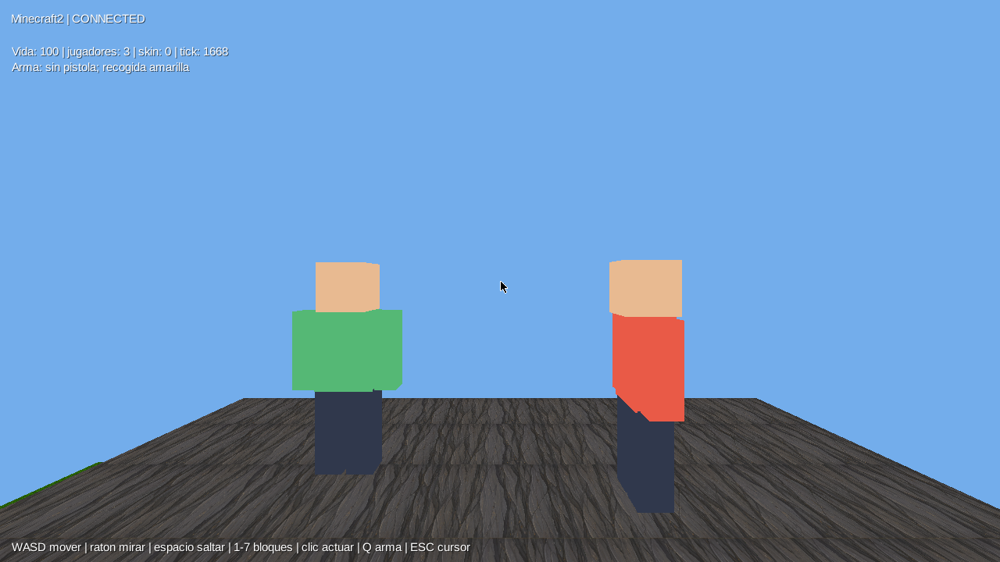
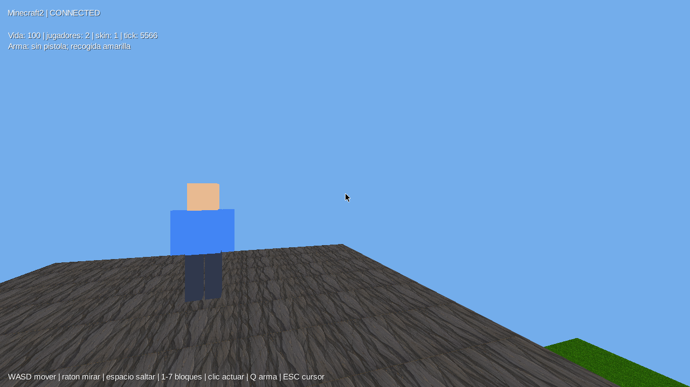

# Comprobación gráfica de C — 16 de noviembre de 2026

Código funcional `f545114`, basado en el merge de Thomas `2df9c14`. Se construyeron ambos Dockerfiles originales de Ethian `fb28706` en un worktree aislado con el código integrado de Jasub. Después se añadieron mensajes de diagnóstico de cierres de lectura/cola de salida al servidor, sin cambiar su simulación; esa versión se usó en la repetición prolongada. No hay medición de FPS ni aceptación de rendimiento basada en estas imágenes.

## Qué se ejecutó

Servidor, dos procesos gráficos LibGDX en contenedores front independientes con Xvfb/Mesa/noVNC, y un cliente de prueba sin GPU de skin 2. Los clientes gráficos usan skins 0 y 1, con la misma configuración MC2 que proporciona el front de Ethian. Se verificó HTTP 200 de noVNC en 6080 y 6081, y contenedores saludables. El segundo front conserva read_only, usuario sin privilegios, no-new-privileges y cap_drop ALL.

La escena usa un mundo JSON v1 de prueba: cuatro chunks con suelo de césped y una plataforma elevada de piedra. Mantiene a los personajes visibles y fuera del alcance inmediato de los zombis; no desactiva la IA ni cambia el juego productivo. No es el escenario de 80 zombis ni una prueba de carga.

El controlador temporal envió teclado por el protocolo VNC al segundo cliente (W/D para avanzar y apartarse; después S/D para cambiar de posición), y ratón para modificar mirada. Es el mismo camino de eventos que llega desde noVNC: GameInput → NetworkInputBuffer → input TCP → simulación → state → render. Los snapshots del cliente de prueba conservaron posiciones y orientación resultantes. El framebuffer se obtuvo mediante RFB; no se editó la imagen.

## Capturas

En la primera vista hay **tres conexiones simultáneas: dos gráficas y una de prueba sin GPU**. El jugador local usa skin 0; ve a los jugadores de skins 1 y 2:

La segunda vista se tomó después de terminar el cliente de prueba; quedan **dos jugadores gráficos**. El jugador de skin 1 ve al de skin 0 desde la posición alcanzada por sus controles de VNC:

Esto verifica representación entre clientes y las tres variantes de color; no demuestra tres clientes gráficos, tres personas jugando ni equivalencia visual completa con el modo local. El modo remoto usa visuales simplificados de zombis/arma, documentados en [cliente-red.md](../../cliente-red.md).

## Incidentes conservados y límites

Las primeras capturas se tomaron cuando los personajes ya habían muerto por zombis y no sirvieron para comprobar skins. Se conservaron fuera del árbol junto con los logs y se repitió con la plataforma controlada. Copiar un helper dentro del rootfs de un contenedor read_only falló; se ejecutó por docker exec sin desactivar el endurecimiento.

En una comprobación anterior, un cliente mostró `FAILED - Server disconnected`. No se estableció su causa y no se atribuye una corrección a los mensajes de diagnóstico añadidos. En la repetición los dos gráficos siguieron conectados durante más de cuatro minutos, sin cierre registrado por lectura o cola de salida. Esa repetición no explica ni borra el incidente previo: debe tenerse en cuenta al revisar estabilidad y despliegue final. El cliente muestra el fallo y permite reconectar reiniciándolo; no tiene reconexión automática.

Los logs completos, snapshots, capturas iniciales, hashes de JAR y configuración de cada ejecución se conservaron en `evidencias/fase-c/`, fuera de target, en Windows y con respaldo en Ubuntu. Las capturas complementan los reportes de pruebas y Actions; no los sustituyen.

## Carga local complementaria de tres clientes

Se ejecutó el consumidor real de Ethian sobre la imagen de servidor construida con el código funcional `f545114`. El worktree del consumidor parte de `c3/ethian` `fb28706`, con el parche de calentamiento conservado fuera de este repositorio. Ese parche pasó aplicación y la suite completa de la copia aislada; sigue siendo una propuesta que Ethian debe integrar y comprobar en Actions.

Servidor en Docker, `MC2_LOAD_ZOMBIES=80`, tres clientes de carga, tres repeticiones de 30 segundos, espera de población de hasta 60 segundos y **30 segundos de tráfico de calentamiento antes de cada repetición**. Los dos clientes gráficos estaban detenidos durante esta medición para medir exactamente tres conexiones de carga y separar el consumo de Mesa. No hubo compilaciones simultáneas.

| Repetición | Tick p95 ms | RTT p95 ms | Zombis mínimos | Fallos / déficit / errores |
| --- | ---: | ---: | ---: | --- |
| 1 | 10,409 | 30,012 | 80 | 0 / 0 / 0 |
| 2 | 7,898 | 54,946 | 80 | 0 / 0 / 0 |
| 3 | 5,993 | 50,063 | 80 | 0 / 0 / 0 |

[CSV del consumidor](carga-tres-clientes.csv) y [veredicto](carga-veredicto.txt). Umbrales conservados: tick ≤16,67 ms y RTT ≤100 ms, con cero fallos/déficit/errores. Es una comprobación local sobre servidor desplegado y calentado, **no CD de Actions, carga desde frío ni rendimiento con los frentes gráficos activos**. La última revisión posterior de código mueve la marca inicial de cuerpo vacante al hilo del tick y añade diagnósticos de transporte; no se atribuye a esa revisión una repetición nueva del benchmark.
